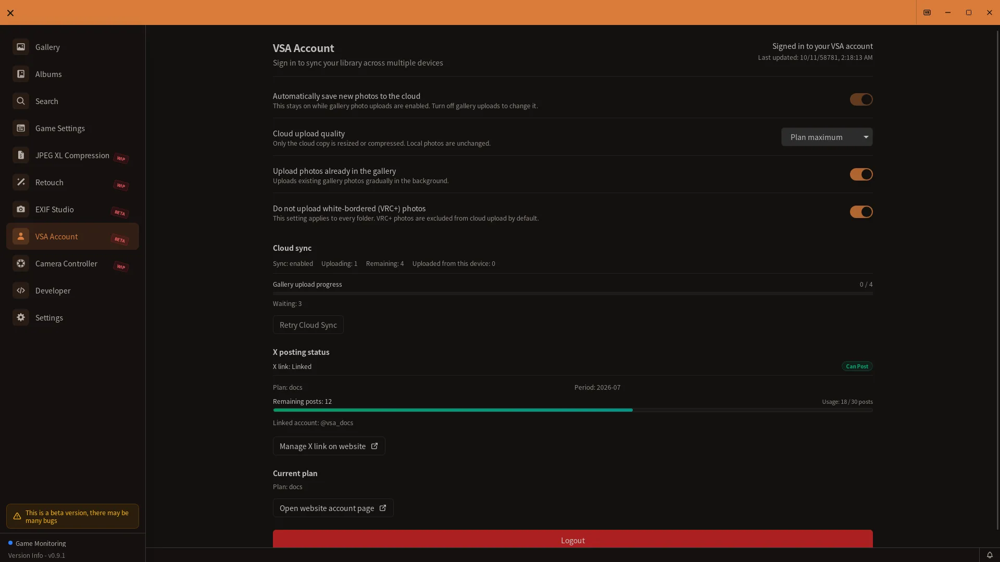

# Account Management Guide

> **Provisional — not generally available; for v0.9.0 in development.** The Account screen is hidden with normal settings. The following describes test environments where the screen is visible, and does not announce general availability or a release date. Controls and behavior may change.

## How to open

In a test environment where **Account** appears in the sidebar, open that entry.

The image is a reference from the released app. Sign-in and backup controls in development may differ.

[🏠 Document Top](../index.md) | [⚖️ Terms of Service](./terms.md) | [🔒 Privacy Policy](./privacy.md)

---

In test environments, Account Management lets you check your VSA account status and configure features such as cloud save, share links, and X posting. This is a provisional guide for features in development. Basic local photo management does not require an account.

## Overview

Depending on your environment, Account Management may offer:

- **VSA Account**: Sign-in, plan, and connection status
- **Cloud Save (optional)**: Cloud backup for favorites and related data
- **Share Links (optional)**: Photo sharing via generated links
- **X Posting**: X connection and posting status

## About Account-Linked Features (Important)

Cloud save, share links, X posting, and related account-linked features are in **staged rollout**. Availability depends on **release status, plan, account status, and environment**.

If a menu or button does not appear in the app, that feature may not be available in your environment yet. For concrete operations, follow the relevant feature guide and the **in-app UI**; use these documents as the canonical source for pricing and data handling:

- [Terms of Service](./terms.md)
- [Privacy Policy](./privacy.md)

Pricing, monthly limits, free tiers, and eligible features follow the website or in-app display. This documentation does not promise fixed overage pricing or uniform feature availability.

## Accessing Account Settings

Click **Account** in the sidebar to open the Account Management screen.

## VSA Account

A VSA account may be required for some optional features (cloud save, share links, X posting). Core local features—import, gallery, local favorites—do not require an account.

**Typical flow** (when shown in the app):

1. Open the Account screen
2. Follow on-screen prompts to sign in or connect services
3. Review plan, connection status, and any error messages

When using the new VSA sign-in service, choose **Sign in on website** from **Account** to open a browser. The app updates its sign-in status after you finish. Third-party service connections may require a separate browser authorization. Your password is not stored in VSA; tokens are kept locally in encrypted form.

### Using a New Account

When using the new sign-in service, create a new account on the VSA website and enter the verification code sent to your email. Accounts, cloud photos, and share links from the previous service do not transfer to the new account automatically.

In a compatible test environment for MainApp v0.9.0 in development, open **Account** from the sidebar and choose **Sign in on website**. Sign in to the new account in the browser; the app updates its status when you finish. These are not instructions for released v0.8.2.

Signing in alone does not enable automatic cloud saving for new photos or backup of registered photos. If you want either feature, enable **Automatically save new photos to the cloud** and **Automatically back up registered photos** separately in Account.

## Cloud Save and Favorites

Favorites work **locally** without cloud features. When cloud save is available in your environment, settings may appear on the Account screen or in favorites-related UI. Labels, toggles, and manual upload options vary by version and rollout—**follow the in-app UI**.

### Cloud Albums

Cloud storage can be enabled only for the local albums you choose. The Albums screen shows syncing and review-required states. If both local and cloud copies changed, review differences in the title, sharing settings, photos, and ordering, then choose which version to keep.

To save an album under a new account, first handle any account-mismatch message on an album linked to the previous cloud account. Choose **Disconnect previous cloud link**, review the confirmation, then select **Disconnect link**. Memberships that exist only in the cloud are removed from this device's album; local photo files and local album memberships remain, and the cloud album itself is not deleted. After disconnecting, choose **Save to cloud too** and confirm to save the album under the new account.

### Manual Photo Uploads

Free and Lite manual uploads support images up to a 3,840px long side; larger images are resized to 4K before upload. Plus and Premium support original quality. Cloud uploads are limited to 64 MiB per photo on every plan.

For local favorites usage, see the [Favorites Guide](favorites-guide.md).

## Share Links

Share links are released in stages. When available, you may create links from photo details or share menus. Scope, expiry, and pricing follow in-app display and the Terms of Service.

## X Posting

X posting is also being prepared for general availability. Connection status may appear on the Account screen in test environments.

## Privacy and Security

### Where Data Is Stored

- **Local favorites and metadata**: On your PC (e.g. under `%APPDATA%\VSA\`)
- **Authentication tokens**: Encrypted locally; used only by VSA
- **Cloud-saved data**: Depends on the cloud service and VSA delivery model—see the [Privacy Policy](./privacy.md)

### External Communication

VSA account, cloud save, share links, X posting, update checks, and server status may involve network requests.

## Troubleshooting

### Sign-In or Connection Does Not Complete

**Symptom**: Browser auth finishes but the app does not return, or times out

**Steps**:

1. Allow pop-ups in your browser
2. Try another browser (Chrome recommended)
3. Check internet and firewall settings
4. Restart VSA and try again

### Cloud Save or Sharing Unavailable

**Symptom**: Menus missing or operations fail

**Possible causes**:

- Feature not rolled out to your environment yet
- Plan or account status does not meet requirements
- Temporary network or third-party outage

**Steps**:

1. Update to the latest app version
2. Check plan and connection status on the Account screen
3. Review the [Terms of Service](./terms.md) and in-app pricing/limit display
4. Keep important photos backed up locally

### Logout and Disconnect

Use logout or disconnect actions shown on the Account screen. After disconnecting, cloud save and share links may stop working. Local photos and favorites usually remain on disk.

## Tips

- **Local first**: Back up important photos locally regardless of cloud features
- **Trust the UI**: During rollout, in-app labels and enabled items are the source of truth
- **Read the terms**: Pricing and data handling are defined in Terms and Privacy on GitHub Pages

## Related Documentation

- [Favorites Guide](favorites-guide.md) - Local favorites and cloud save overview
- [Settings Guide](settings-guide.md) - App configuration
- [Troubleshooting Guide](troubleshooting.md) - Detailed problem solutions
