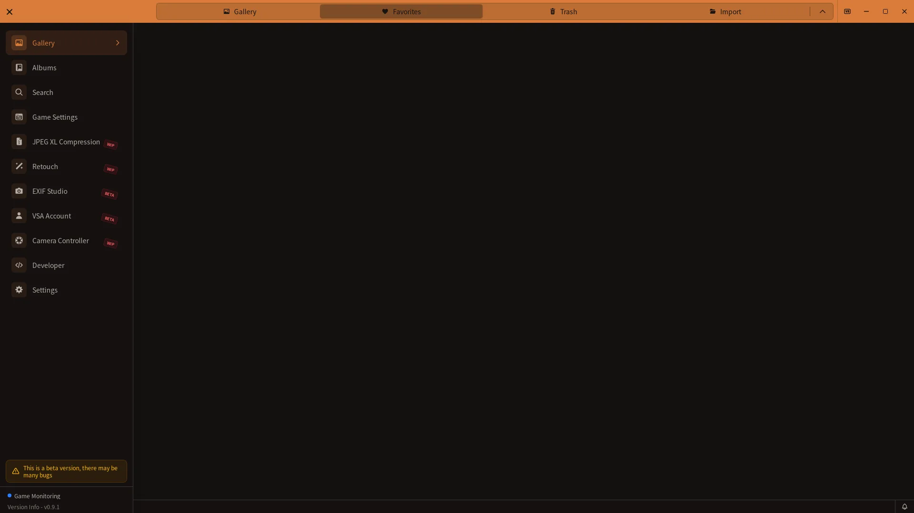

# Favorites Feature Guide

## How to open

Open **Gallery** from the sidebar, then select the **Favorites** tab at the top.

This image is a reference from VSA v0.8.2. The VSA v0.9.0 screen may look different.

[🏠 Document Top](../index.md) | [⚖️ Terms of Service](./terms.md) | [🔒 Privacy Policy](./privacy.md)

---

The Favorites feature lets you mark important screenshots and manage them locally. When a favorites folder is configured, VSA copies favorited photos there.

## Overview

With Favorites, you can:

- **Mark Important Photos**: Add star marks to special screenshots
- **Dedicated View**: Browse only your favorite photos in one place
- **Export**: Copy selected favorites to any folder
- **Efficient Management**: Organize and access your best moments quickly

## Adding Favorites

### Method 1: Gallery Grid View

Mark photos as favorite directly from the gallery thumbnail display.

**Steps**:
1. View the gallery grid
2. Locate the star icon (★) on the thumbnail's top-right corner
3. Click the star icon
4. Star fills in, indicating photo is now a favorite

### Method 2: Photo Detail Sidebar

Mark favorites from the detailed photo information panel.

**Steps**:
1. Click a photo in the gallery
2. Photo detail sidebar opens on the right
3. Click the star (★) button at the top of the sidebar
4. Star fills in to confirm favorite status

### Method 3: Table View

Mark favorites from the list/table display.

**Steps**:
1. Switch to Table view
2. Locate the star (★) column
3. Click the star cell for desired photo
4. Favorite status updates immediately

**Sync Note**: Favorite status syncs between Grid and Table views. Mark as favorite in either view and it appears in both.

## Favorites View

### Accessing Favorites

**Steps**:
1. Open **Gallery** from the sidebar
2. Select the **Favorites** tab at the top
3. All marked favorite photos display

### Display Format

**Grid Display**:
- Thumbnails organized in grid layout
- Responsive columns based on window size

**Displayed Information**:
- Thumbnail image
- Metadata on hover (world name, date, etc.)
- Capture timestamp
- World information

### Selection Mode and Bulk Operations

Click **Selection Mode** to select multiple photos. The selection toolbar provides **Select all**, **Cancel**, **Export selected**, and **Remove Selected**. VSA asks for a destination folder each time you export.

### Removing a Favorite

To remove one photo, open the photo detail sidebar and click the star button again. To remove several at once, choose **Selection Mode** in Favorites, select the photos, then choose **Remove Selected**. Removing one favorite with the star button in the detail sidebar leaves the original photo in Gallery and deletes the copy tracked by VSA. Choosing Remove selected in Selection Mode only clears favorite status; it leaves both the original photo and the copy in the favorites folder.

## Data Management

### Favorites Folder

Choose the destination in Settings > **Favorites**. When a folder is configured, favoriting a photo copies the original there. Removing one favorite with the star button in the detail sidebar also deletes the copy tracked by VSA. Copies remain when favorites are removed in bulk from Selection Mode.

If you changed the destination and want to copy existing favorites there, use **Migrate favorite photos** in the same panel. The result shows successful and failed counts and details for failed photos.

Migration copies the currently marked photos to the selected folder and clears the migrated favorite state. Confirm the result before deleting or reorganizing any source files.

### Export and Backups

From Favorites > **Selection Mode**, choose **Export selected** and select any destination folder. To make a long-term backup, close VSA and copy the configured favorites folder and the original photo folder. Do not edit or replace VSA-managed data manually.

## Troubleshooting

### Favorites Not Saving

**Symptom**: Marked photos revert to non-favorite after restart

**Possible Causes**:

**Disk Space Issues**:
- Check available disk space
- Ensure at least 1GB free
- Clear unnecessary files
- Retry marking favorites

**File Permission Problems**:
1. Right-click `%APPDATA%\VSA\` folder
2. Open Properties
3. Check Security tab
4. Verify Write permission enabled
5. Apply if needed

**If the problem persists**:
- Check free space and write permission for the configured favorites folder
- Contact support with the VSA log and reproduction steps

## Privacy and Security

### Data Protection

**Favorite Data**:
- Favorite state is stored locally by VSA, and copied images are stored in the configured folder

## Tips

- **Regular Backups**: Back up the configured favorites folder periodically
- **Offline use**: You can mark and view favorites without an internet connection.

## Related Documentation

- [Gallery Operation Guide](gallery-guide.md) - Photo browsing and selection
- [Troubleshooting Guide](troubleshooting.md) - Detailed problem solutions
