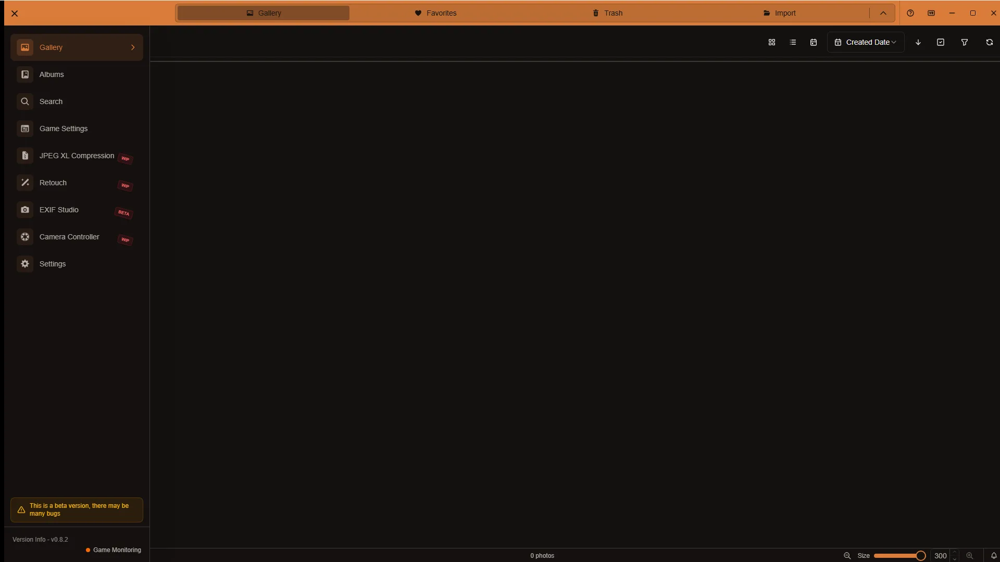

# Gallery Guide

## How to open

Open **Gallery** from the VSA sidebar.

[🏠 Document Top](../index.md) | [⚖️ Terms of Service](./terms.md) | [🔒 Privacy Policy](./privacy.md)

---

The gallery screen allows you to view imported photos in a list format, check detailed information, and perform operations such as adding favorites.

> **Note (Integral parameters)**
> Integral is supported, but some camera parameter values may not be recorded or displayed correctly.

## Display Modes

The gallery has three display modes.

### Grid View

Displays photos in a thumbnail grid format.

- Easy to visually check images
- Adjustable thumbnail size (50px-300px)
- Date-based grouping (when thumbnail size is small)

### Table View

Displays photos in a list format.

- View file name, capture time, world name at a glance
- Click column headers to sort
- Resizable columns

Switch display modes using the toolbar button.

### Group View

Groups photos by capture date. Like grid view, the thumbnail size can be adjusted.

## Sorting

You can sort by the following items.

| Sort Item | Description |
|-----------|-------------|
| Created Date | File creation date |
| World Name | VRChat world name |
| File Name | Alphabetical order of file names |
| File Size | File size |
| Capture Time | Photo capture time (descending by default) |

How to sort:

1. Select an item from the sort dropdown in the toolbar
2. Toggle ascending/descending with the arrow button
3. In table view, you can also click column headers to sort

## Zoom Controls

You can change the thumbnail size in grid view.

### Keyboard Shortcuts

| Action | Shortcut |
|--------|----------|
| Zoom In | `Ctrl` + `=` |
| Zoom Out | `Ctrl` + `-` |

### Mouse Controls

- `Ctrl` + Mouse Wheel: Zoom centered on mouse position

### Slider

You can also adjust the size using the slider in the toolbar.

## Image Detail Sidebar

Click a photo to display a sidebar on the right showing detailed information.

### Displayed Information

**Basic Info:**
- Preview image (click to open in default app)
- File path
- File hash

**VRChat Info:**
- World name (copyable)
- Photographer name
- Capture time
- List of users in the instance

**Camera Info:**
- Camera type (VirtualLens2, Integral, FishEye, TelePortraitLens, or Normal Camera)
- VirtualLens2 parameters (Aperture, FocalLength, Exposure, etc.)
- Integral parameters (ShutterSpeed, BokehShape, etc.)
- Stored TelePortraitLens snapshot values when available

Normal Camera parameters are not recorded in the shipped v0.8.2 release. The v0.9.0 development version records and displays only values VSA could confirm over OSC at capture time. Unconfirmed values are not included, and available fields depend on what OSC provides.

In the v0.9.0 development version, for a Normal Camera photo registered locally with its PNG file present, open **Correct Focus mode** under **Normal Camera** in the photo details, choose a **Focus mode**, and click **Save**. The selection is written to the photo's PNG, and the photo details refresh after a successful save. This control is not available in v0.8.2. The existing screenshot may not show development controls.

Camera information is displayed in an accordion format and can be expanded by clicking.

### Image Detail Sidebar Buttons

The following buttons are arranged at the top of the detail sidebar:

#### QR Code Read Button

A "Read QR Code" button displays above the preview image in the detail sidebar.

**Features**:
- Auto-detect QR codes in images
- Support for multiple QR codes (detects all in image)
- Detected QR codes display with overlay on image

**How to Use**:
1. Click photo to open detail sidebar
2. Click "Read QR Code" button
3. QR codes auto-detect
4. Box displays on detected QR code

**Processing Detected Results**:
- **URL**: Click "Open in Browser" to open in browser
- **Text**: Click "Copy to Clipboard" to copy content
- Multiple code detection displays all codes

## Favorites

You can mark photos as favorites.

### How to Use

- Click the star icon on the thumbnail
- Click the star button in the detail sidebar
- Click the star icon in table view

Favorite status is saved locally and persists after restarting the app.

## Deleting Images

You can move unwanted images to the trash.

1. Click an image to open the detail sidebar
2. Click the trash icon
3. Select "Delete" in the confirmation dialog

Deleted images are moved to VSA's trash. Restore them from the trash or permanently delete them in selection mode.

## User Search

Search for photos containing specific users from the user list displayed in the detail sidebar.

### Click Username to Search

**Steps**:
1. Click photo to open detail sidebar
2. Click username from "List of users in the instance" section
3. Auto-navigate to user search screen
4. Photos containing that user display in list

### AND Search with Multiple Users

Search multiple users simultaneously to display only photos with all users.

See [Person Search Guide](person-search-guide.md) for details.

## Bulk Selection Feature

Select multiple photos simultaneously to add favorites, add to albums, or move photos to trash.

### Start Selection Mode

**Steps**:
1. Open Gallery tab
2. Click "Selection Mode" button in toolbar
3. Bulk selection mode enables
4. Toolbar display changes showing selection operation buttons

### Photo Selection and Deselection

**Selection Method**:
- Grid view: Click thumbnail to select
- Table view: Click row to select
- Click selected photos again to deselect

**Select All**:
1. Click "Select All" button in toolbar
2. All photos on screen select

**Deselect**:
1. When all photos are selected, click "Select All" again
2. Or click "Cancel" to leave selection mode
3. All selections clear

### Selection Display

Selected photos show:

- Grid view: Checkmark on thumbnail
- Table view: Row highlight, checkbox on left
- Toolbar shows "n selected"

### Bulk Operations

With multiple photos selected, perform these operations:

#### Add Favorites in Bulk

**Steps**:
1. Select multiple photos
2. Click "Add to Favorites" button in toolbar
3. All selected photos add to favorites

#### Move to Trash in Bulk

**Steps**:
1. Select multiple photos
2. Click "Move to Trash" button in toolbar
3. Click "Move" in confirmation dialog
4. All selected photos move to trash

#### Add to an Album in Bulk

1. Select multiple photos
2. Click "Add to Album" in the toolbar
3. Choose the destination album

Up to 200 photos can be added at once.

### Exit Selection Mode

**Steps**:
1. Click "End Selection Mode" button in toolbar again
2. Or click "Cancel" button
3. Selection mode ends, all selections clear

## Trash Tab

In the trash tab, confirm deleted photos, restore them, or permanently delete.

### Access Trash Tab

**Steps**:
1. Check tab menu above Gallery
2. Four tabs display: "Gallery", "Favorites", "Trash", and "Import"
3. Click "Trash"

### Trash View Features

Trash view uses a thumbnail grid. Each card shows the world name and days remaining before automatic deletion. More cards load as you scroll.

**Deleted Photo List**:
- Photos are listed by most recent deletion time
- Check the world name and days remaining before automatic deletion
- Select cards for bulk actions

### Restore Feature

Restore deleted photos to gallery.

**Steps**:
1. Open the Trash tab
2. Click **Selection Mode**
3. Select the photo cards to restore
4. Click **Restore** in the toolbar
5. Confirm the action
6. Photos return to the gallery

**Bulk Restore**:
1. Select multiple photos
2. Click "Restore" button in toolbar
3. All selected photos restore

### Permanently Delete Feature

Delete the photo file, thumbnail, and related data from VSA's trash. This cannot be undone.

**Steps**:
1. Open the Trash tab and click **Selection Mode**
2. Select the photo cards to delete
3. Click **Delete** in the toolbar
4. Confirm the action

**Bulk Permanent Delete**:
1. Select multiple photos
2. Click **Delete** in the toolbar
3. Confirm the action

### Notes

**Retention**:
- Photos moved to the app trash are automatically deleted after 7 days

**About Permanent Deletion**:
- VSA removes the photo data from its trash, so it cannot be restored
- Back up important photos beforehand

## Keyboard Shortcuts

| Action | Shortcut |
|--------|----------|
| Zoom In | `Ctrl` + `=` |
| Zoom Out | `Ctrl` + `-` |
| Fullscreen | `F11` |

## Toolbar Operations

The toolbar is displayed at the top of the screen.

- Move mouse to the top of the screen (within 100px) to show
- Expand/collapse button to pin display
- Reload button to refresh the image list

## Performance

The gallery performs smoothly even with large numbers of images thanks to virtualization technology.

- Only renders images visible on screen
- Lazy loading of thumbnails

## Filters

Use the filter button in the toolbar to filter by capture date range, metadata presence, world name, or username. Enter multiple usernames separated by commas for an AND search. Use **Reset** in the filter menu to clear the conditions.
