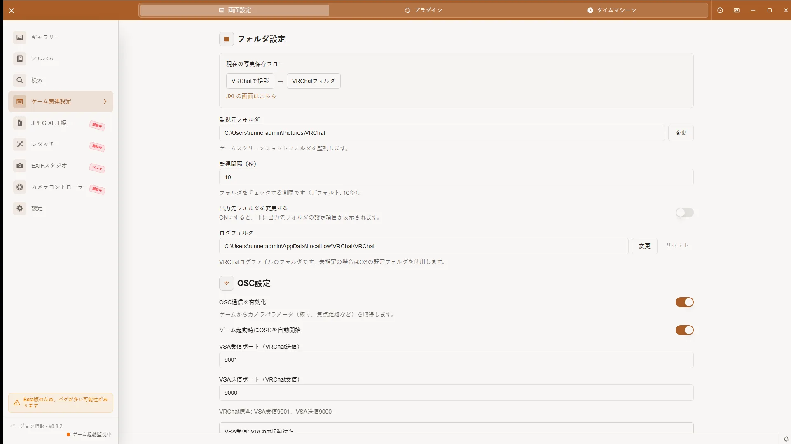

# Game Settings Guide

## How to open

Open **Game Settings** from the VSA sidebar.



[🏠 Document Top](../index.md) | [⚖️ Terms of Service](./terms.md) | [🔒 Privacy Policy](./privacy.md)

---

Game Settings controls VRChat photo import, log parsing, OSC communication, and the optional startup plugins. Changes are saved automatically; there is no Save button. The **Game Settings** panel under Settings contains only Display Settings (folders and OSC); open the three-tab screen from the sidebar.

Some current labels in these screens are Japanese even when the rest of the app is localized.

> **Note (Integral parameters)**
> Some Integral camera parameter values may not be recorded or displayed correctly in the current implementation.

## Tabs

The top tab bar contains three tabs:

- **Display Settings**: Watch, output, and log folders plus OSC
- **Plugins**: Steam, Virtual Desktop, and VRChat outage notifications
- **Time Machine**: VRChat log event timeline

### Monitoring status

The current screen does not have a manual start/stop monitoring switch. Monitoring starts according to the app configuration, and the sidebar shows its current status. Keep VSA running with a watch folder configured to import new screenshots automatically.

## Display Settings

### Folder settings

#### Watch folder

Select the folder where VRChat saves screenshots by clicking **Change**. The usual default is:

```
C:\Users\[Username]\Pictures\VRChat
```

VSA watches this folder for new game screenshots. The **Watch interval (seconds)** field offers 1–60 seconds in the UI and defaults to 10 seconds.

#### Output folder

Enable **Change output folder** to show the output-folder selector. The setting becomes active after you choose a folder; when it is off, VSA uses the VRChat folder.

After choosing an output folder, VSA checks the watch folder for VSA-managed photos.

- If candidates are found, choose **Move photos too** to move the listed items.
- If no candidates are found, choose **Change path only**.
- If a same-name file with different content is found, migration detects the conflict and attempts a rollback; the originals and settings are kept.
- The migration dialog shows the count, percentage, and current file.

The watch folder itself, a parent/child folder of it, and a folder that does not exist cannot be selected. The migration dialog has no cancel action.

Use **Reset** to return to the default output behavior. Automatic JXL archives follow the current photo output folder in its `VSA-Archive` subfolder.

#### Log folder

VSA reads VRChat logs from this folder to obtain world and user information and to build the Time Machine timeline. When unset, the OS default is used.

- **Change** selects a VRChat log folder.
- **Reset** returns to the OS default.

The usual log folder is:

```
C:\Users\[Username]\AppData\LocalLow\VRChat\VRChat
```

### OSC settings

OSC (Open Sound Control) lets VSA receive camera parameters from VirtualLens2, Integral, FishEye, and TelePortraitLens.

- **Enable OSC communication**: Turns OSC communication on.
- **Start OSC automatically when the game starts**: Starts OSC when VRChat is detected. This switch is disabled while OSC is off.
- **VSA receive port (VRChat sends)**: Port for messages from VRChat to VSA; default `9001`.
- **VSA send port (VRChat receives)**: Port for messages from VSA to VRChat; default `9000`.

VRChat's standard pairing is VSA receive `9001` and VSA send `9000`. If another OSC application uses a port, change the corresponding values on both sides. If the receive port is busy, VSA may move to another port and show a warning.

### Automatic saving

Switches save immediately; numeric fields save after input settles. Folder-selection and migration results are shown in notifications, while plugin failures appear on the card. The Game Settings screen has no manual **Save settings** button.

## Plugins

Use the switch on each card to enable or disable a plugin. Click a card to see its current state and details. Cards show **Needs attention** or **Unavailable** when the environment or an external setting prevents normal operation.

### Start VSA with VRChat (Steam)

Starts VSA when VRChat is launched from Steam. This is available for Steam VRChat on Windows (App ID `438100`).

- Quit Steam before changing the switch.
- VSA adds its launch entry to Steam Launch Options.
- If Steam-side options were changed elsewhere, VSA does not overwrite them automatically.
- When a conflict is shown, review the Steam options and retry.

### Launch VRChat when Virtual Desktop connects

After Virtual Desktop and the headset connect, VSA launches VRChat only when VRChat is not already running. This is available on Windows and requires VSA to be running.

### VRChat outage notifications

VSA checks the official VRChat status and notifies you about outages and maintenance every 5 minutes. The plugin detail view provides switches for:

- Outage notifications
- Scheduled or active maintenance notifications
- In-app toast notifications in the bottom-right corner
- Windows notification-center notifications

The detail view also shows the overall status, possible stale data, last check, next update, online player count, maintenance, unresolved incidents, and per-component server status. **Manual refresh** has a 60-second cooldown. **View official details** opens the official VRChat status page.

## Time Machine

Search and review events parsed from VRChat logs. A correct log-folder setting is required.

### Filters

- Presets: **Last day / Last week / Last month / All time**
- Custom: start and end dates
- Event type: **All events / World entered / World left / User joined / User left**
- Search: user name, world name, or log text

The event table shows time, event type, world, and user. Click a user name to filter by that user; use **Clear** to remove it. **Refresh** reloads the list, which is paginated at 50 events per page.

## Troubleshooting

### Photos are not imported automatically

1. In **Display Settings**, verify that the watch folder is the actual VRChat screenshot folder.
2. Leave VSA running and check that the sidebar reports folder monitoring.
3. Check the watch interval (1–60 seconds in the UI) and confirm that a new image is created in the selected folder.
4. Check folder read permissions and whether security software is blocking VSA.

### World or user information is missing / the timeline is empty

1. In **Display Settings > Log folder**, select the folder that contains VRChat logs.
2. After VRChat records a world move or user event, check a new photo or refresh the timeline.
3. If no log exists, launch VRChat, enter a world once, and check whether a log is created.

### OSC camera information is missing

1. Enable **OSC communication**.
2. Enable OSC in VRChat and verify VSA receive `9001` / VSA send `9000` (or the corresponding custom values).
3. Enable OSC output in the camera you use (VirtualLens2, Integral, FishEye, or TelePortraitLens).
4. Check for port conflicts and firewall rules. Also check whether VSA warned that it moved the receive port.

### The Steam plugin cannot be changed

Quit Steam completely and retry. If the card says **Needs attention**, review VRChat's Steam Launch Options and preserve wrappers or arguments belonging to other applications while adjusting only the VSA portion.

### Server status does not update

Check the network connection and try **Manual refresh**. Manual refresh cannot be run again during its 60-second cooldown. If data may be stale, compare it with the official status page.

## Related documentation

- [VRChat Integration Guide](vrchat-integration.md) - Metadata and OSC behavior
- [JXL Compression Guide](jxl-compression.md) - Automatic archiving
- [Settings Guide](settings-guide.md) - All settings panels
- [Initial Setup Guide](setup-wizard.md) - First-run folder and startup settings
- [Troubleshooting Guide](troubleshooting.md)
- [FAQ](faq.md)
