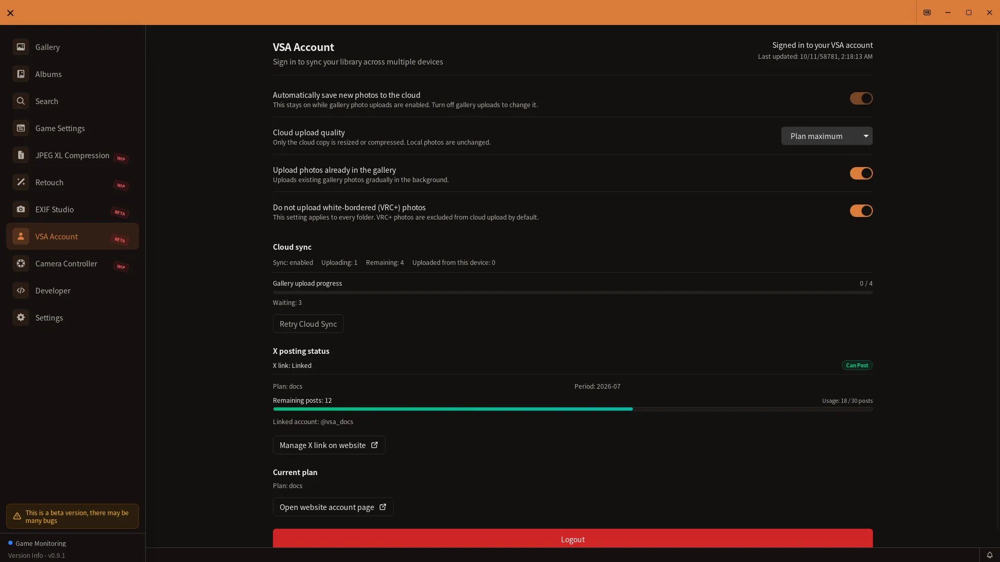

# Cloud Integration Guide

> **Provisional — not generally available.** This page describes the VSA v0.9.0 development build. The features are hidden with normal settings. This page is available by direct URL. Screens and behavior may change.

## How to open

In a test environment where cloud controls are visible, open **Account** or **Albums** from the sidebar. These cloud controls are hidden with normal settings.

This image is a reference from released v0.8.2. The current v0.9.0 development build may look different.

[🏠 Document Top](../index.md) | [⚖️ Terms of Service](./terms.md) | [🔒 Privacy Policy](./privacy.md)

---

## Account connection

When the Account screen and linking features are available, follow the on-screen prompts to sign in and check the connection status. Authentication methods and screens may change between versions. Check the current UI, Terms, and Privacy Policy.

## Cloud album operations

When cloud features are shown, use the Albums screen:

1. Browse albums in the cloud list. Select an album and choose **Import locally** to use it as an album on this device.
2. To save a local album to the cloud, open it, choose **Save to cloud too**, and confirm.
3. For a linked album, choose **Pause sync** or **Resume sync**. If both this device and the cloud have changed, choose **Review conflict** to compare the versions and select which one to use.

The cloud list is for viewing. Read each confirmation before choosing an operation that removes an album or photo from this device or the cloud.

## Cloud sync for favorites

Favorites and export remain available locally when cloud features are hidden. Where account-linked sync is available, follow the status and retry controls shown in the app. The Favorites screen itself is for selecting photos, exporting them, and removing favorites.

This guide does not set availability, prices, or usage limits. Check the in-app display and the [Terms of Service](./terms.md). See the [Privacy Policy](./privacy.md) for data handling.
