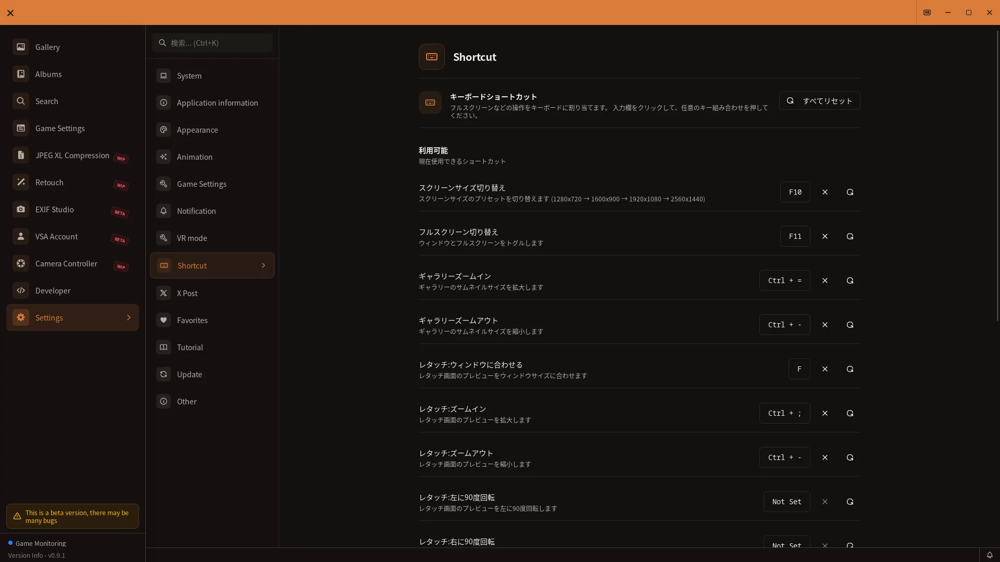

# Keyboard Shortcuts List

## How to open

Open **Shortcuts** from Settings.

[🏠 Document Top](../index.md) | [⚖️ Terms of Service](./terms.md) | [🔒 Privacy Policy](./privacy.md)

---

Here is a list of keyboard shortcuts available in the VSA app. This guide explains all shortcuts and how to customize them.

## Implemented Shortcuts

Currently, the following 9 shortcuts are implemented.

### Display Shortcuts

| Operation | Shortcut | Description |
|-----------|----------|-------------|
| Screen Size Toggle | `F10` | Switch window size between presets (1280×720 → 1600×900 → 1920×1080 → 2560×1440) |
| Fullscreen Toggle | `F11` | Toggle between windowed and fullscreen modes |
| Gallery Zoom In | `Ctrl` + `=` | Increase gallery thumbnail size |
| Gallery Zoom Out | `Ctrl` + `-` | Decrease gallery thumbnail size |
| Retouch Fit to Window | `F` | Fit the retouch preview to the window |
| Retouch Zoom In | `Ctrl` + `;` | Increase the retouch preview size |
| Retouch Zoom Out | `Ctrl` + `-` | Decrease the retouch preview size |
| Retouch Rotate Left | Check the current binding in Settings > Shortcut | Rotate the retouch preview 90 degrees left |
| Retouch Rotate Right | Check the current binding in Settings > Shortcut | Rotate the retouch preview 90 degrees right |

### Shortcut Details

#### Screen Size Toggle (F10)

Change the window size in stages.

**Size Order**:
1. 1280 × 720 (default)
2. 1600 × 900
3. 1920 × 1080 (Full HD)
4. 2560 × 1440 (2K)
5. Back to 1280 × 720 (cycle)

**Use Cases**:
- Optimize screen size in multi-monitor environments
- Check display on different resolutions

#### Fullscreen Toggle (F11)

Switch between windowed and fullscreen modes.

**In Fullscreen Mode**:
- Title bar and taskbar are hidden
- Application displays on entire screen
- Photo viewing area is maximized

**In Windowed Mode**:
- Title bar and window frame are visible
- Resizing and dragging are possible
- Other applications can be displayed simultaneously

#### Gallery Zoom In (Ctrl + =)

Increase the thumbnail size in the gallery.

**Behavior**: Each press increases the gallery thumbnail or row size by one step.

**Use Cases**:
- View photo details in larger size
- Use with high-resolution monitors

#### Gallery Zoom Out (Ctrl + -)

Decrease the thumbnail size in the gallery.

**Behavior**: Each press decreases the gallery thumbnail or row size by one step.

**Use Cases**:
- Display many photos at once
- Quick review of large photo collections
- View date grouping

#### Retouch Shortcuts

- `F`: Fit the preview to the window
- `Ctrl + ;` / `Ctrl + -`: Zoom in and out
- Rotation: Check the current binding in Settings > Shortcut. In development build v0.9.0, it may be unassigned.

## Customization

### Changing Shortcut Keys

You can change default shortcuts to different key combinations.

**Steps**:

**Step 1: Open Settings**
1. Click the gear icon (⚙️) in the sidebar
2. The "Settings" screen appears

**Step 2: Select Shortcut Panel**
1. Click "Shortcut" from the left menu
2. All registered shortcuts are displayed

**Step 3: Click the Shortcut to Change**
1. Click the shortcut row you want to change
2. The field becomes active (highlighted)

**Step 4: Enter New Key Combination**
1. Hold modifier keys (Ctrl, Shift, Alt, Meta, etc.) and press the main key
2. Input appears on screen
3. Release keys to confirm

**Step 5: Automatic Save**
1. The shortcut is updated as soon as the key input is accepted
2. There is no manual Save button

### Input Examples

**Example 1: Change to Ctrl + Shift + =**
1. Click the shortcut to change
2. Hold Ctrl key
3. Hold Shift key
4. Press = key
5. "Ctrl + Shift + =" appears
6. The new binding is saved automatically.

**Example 2: Change to Single Key Only**
1. Click the shortcut to change
2. Press only the main key without modifier keys
3. Example: "F2" (reserved keys such as F5 cannot be registered)
4. The new binding is saved automatically.

### Reset to Default

To restore all shortcuts to default values:

**Steps**:
1. Open Settings > "Shortcut" panel
2. Click **Reset all**
3. All shortcuts return to defaults

**Note**: This action cannot be undone. If important, note current settings beforehand.

## Important Notes

### System Shortcut Conflicts

Conflicts may occur with Windows system shortcuts.

**Common Conflicting Shortcuts**:
- `Alt + Tab`: Window switching
- `Ctrl + C`: Copy
- `Ctrl + V`: Paste
- `Win` key combinations: Windows-specific operations

**If Conflict Occurs**: Browser/OS-reserved shortcuts and duplicate bindings on the same screen cannot be registered.

**Solution**:
- Change to a different key combination
- Use non-conflicting keys in Windows settings

### Shortcut Scope

Shortcuts are active while VSA is in focus, with some limited to a specific screen.

**Shortcuts Active Only in Specific Screens**:
- Gallery Zoom (In/Out): Active only in the gallery screen
- Retouch shortcuts: Active only in the retouch screen
- Screen size and fullscreen: Active throughout VSA

### Keyboard Layout Differences

Display may differ depending on your keyboard layout.

**Examples**:
- Japanese keyboard: = key position differs
- US layout keyboard: Key positions differ

**Solution**:
- Test input to confirm expected keys are entered
- If different, change to another key

## Troubleshooting

### Shortcut Not Working

**Symptom**: Keys do not respond

**Causes and Solutions**:

**Modifier Keys Not Recognized Correctly**:
1. Check Settings > Shortcuts for registered key combinations
2. Confirm expected keys are set

**VSA Window Not Active**:
1. Click the VSA window
2. Confirm window is active (in front)
3. Ensure no other app is active

**Windows System Shortcut Takes Priority**:
1. Change to different key combination
2. Check Windows settings for conflicting shortcuts

### Shortcut Settings Reset

**Symptom**: Custom shortcuts return to default after app restart

**Causes**:
- Settings file corruption
- Insufficient disk space
- Permission issues

**Solution**:
1. Reconfigure settings
2. Restart app
3. If still unresolved, check write permission and free space for the settings folder

### Keyboard Layout Not Recognized

**Symptom**: Keyboard layout differs, expected keys don't input correctly

**Solution**:
1. Check Windows keyboard settings
2. Adjust for your keyboard layout
3. If problem persists, try different key combinations

## Tips

- **Frequent Shortcuts**: Screen size toggle is convenient in large monitor environments
- **Zoom Feature**: Ctrl + = and Ctrl + - quickly adjust gallery sizes
- **Retouch**: Use F, Ctrl + ;, and Ctrl + - to control the preview. Check Settings for the current rotation binding.
- **Fullscreen**: F11 for fullscreen to view photos on large display
- **Dual Monitor**: Use F10 to adjust size and move windows between monitors

## Related Documentation

- [Settings Guide](settings-guide.md) - Shortcut settings details
- [Gallery Guide](gallery-guide.md) - Gallery zoom feature details
