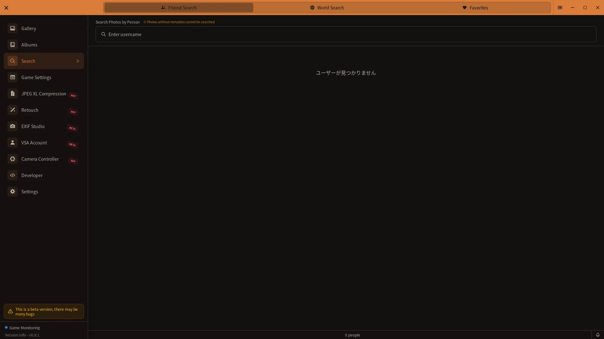

# Person Search Feature Guide

## How to open

Open **Person Search** from the VSA sidebar.

[🏠 Document Top](../index.md) | [⚖️ Terms of Service](./terms.md) | [🔒 Privacy Policy](./privacy.md)

---

The Person Search feature lets you quickly find photos containing specific VRChat users or taken in a specific world. Search by username or world name, use romaji (romanized Japanese), and find photos with multiple people using AND logic.

## Overview

With Person Search, you can:

- **Tag-Based Search**: Add usernames as tags
- **Multiple User Search**: Find photos with up to 5 people (AND search)
- **Romaji Support**: Type Japanese names in romanized form
- **World Search**: Find photos by world name
- **Favorites**: Save frequently searched users and worlds
- **User Directory**: Browse all users in your photo collection

## Prerequisites

Person Search requires VRChat metadata in your photos.

### Required Metadata

**What You Need**:
- Photos must have VRChat metadata attached
- Metadata comes from VRChat log files
- Requires a correct watch-folder and log-folder setup in Game Settings

**How Metadata is Added**:
1. VRChat screenshot captured
2. VSA "Game Settings" watches the screenshot folder and reads VRChat logs
3. User names extracted from logs
4. Metadata embedded in screenshot

**When Metadata is NOT Added**:
- Photos from before Game Settings setup
- VRChat not running during screenshot
- VRChat logging is unavailable
- Game Settings watch or log folder is not configured correctly

**Setup Required**:
See [Game Settings Guide](game-config.md) to enable metadata extraction.

## Search Methods

### Tag-Based Search

Add usernames as searchable tags.

**Step-by-Step**:

**Step 1: Open Person Search**:
1. Click "Person Search" in the sidebar
2. Person Search panel opens

**Step 2: Enter Username**:
1. Click in the search input field
2. Type username (full or partial)
3. Dropdown suggestions appear

**Step 3: Select from Suggestions**:
1. Dropdown shows matching users
2. Click desired username
3. Or use arrow keys and Enter
4. Username added as tag

**Step 4: View Results**:
1. Photos containing that person display below
2. Grid format shows all matching photos
3. Click photo for detail view

### Romaji Search Support

Search for Japanese names using romanized spelling.

**Examples**:
- Japanese: 田中
- Romanization: tanaka or TANAKA
- Both versions work in search

**How Romaji Works**:
- Japanese names converted to romaji automatically
- Can search with full spelling: "yamada"
- Can search with partial: "yam" or "ma"
- Case-insensitive matching

**Input Tips**:
- Use English character input (not Japanese input mode)
- Disable Japanese IME while typing
- Type in English keyboard layout
- Partial matches work

**Testing Romaji**:
1. Set input to English (A key shows keyboard English indicator)
2. Type romanized name (example: "tanaka")
3. Suggestions show matching users
4. Click to select

### Multiple User AND Search

Find photos with multiple specific people.

**What is AND Search**:
- Only photos with ALL selected people display
- Example: Select "Alice" AND "Bob"
- Results show only photos with both Alice and Bob

**How to Do AND Search**:

**Step 1: Add First User**:
1. Enter first username
2. Select from dropdown
3. Tag appears in search bar

**Step 2: Add Second User**:
1. Click search field again
2. Enter second username
3. Select from dropdown
4. Second tag added

**Step 3: Continue Adding**:
1. Repeat for up to 5 people total
2. Each addition shows AND results
3. Results filter automatically after each tag

**Maximum Users**:
- Maximum: 5 users per search
- Limitation for performance
- 6th user cannot be added

**Removing Tags**:
1. Click × button on tag
2. Tag removes immediately
3. Results update automatically

## World Search

Use the **World Search** tab at the top of Person Search to find photos by world name.

**Steps**:
1. Open the **World Search** tab
2. Type part or all of a world name
3. Click the desired world in the filtered list
4. View photos taken in that world

**Notes**:
- Click the heart beside a world name to add it to favorites
- One world can be selected at a time
- The selected world and photo count are shown above the results
- Click the × button to clear the selected world
- Photos normally load in batches of about 50 as you scroll

## User Directory

Browse all users in your photo collection.

### Complete User List

**Display Format**:
- **Alphabetical Order**: あ行 → か行 → ... (Japanese 50-on order)
- **User Names**: Shows Japanese and romanized versions
- **Photo Count**: Number of photos each user appears in
- **Favorite Star**: Indicates if marked as favorite

### Scrolling and Searching

**Browse Method**:
1. Scroll through user list
2. Find desired username
3. Click username
4. Photos with that person display

**Search Method**:
1. Type in search field
2. List filters to matching users
3. Select from filtered results
4. Photos display

### Favorite Users Management

Mark frequently searched users as favorites.

**Adding to Favorites**:
1. In user directory, find username
2. Click star (☆) icon next to name
3. Star fills (★) indicating favorite
4. User added to favorites list

**Removing from Favorites**:
1. Click filled star (★) again
2. Star empties (☆)
3. User removed from favorites

## Favorites Tab

Person Search has **Friend Search**, **World Search**, and **Favorites** tabs. In Favorites, use **Favorite type** to switch between friends and worlds.

### Favorite Users

- Select **Friends** in **Favorite type**
- Only marked users are shown
- Click a user name to search that user's photos
- Click the star to remove the user from favorites

### Favorite Worlds

- Select **Worlds** in **Favorite type**
- Only marked worlds are shown
- Click a world name to search its photos
- Click the heart to remove the world from favorites

## Search Results Display

### Grid Layout

Results display in photo grid format.

**Characteristics**:
- Responsive columns (adjusts to window size)
- Click thumbnail for detail view
- Hover for metadata preview
- Smooth scrolling

**Display Information**:
- Thumbnail image
- Metadata on hover (world, date)
- File information available
- Camera settings accessible

### Infinite Scroll

Automatically load more photos as you scroll.

**How It Works**:
1. Scroll to bottom of results
2. Automatic load of next batch (typically 50 photos)
3. "Loading..." indicator appears
4. Repeat process for all results

**Performance**:
- 50-photo batches optimize performance
- Smooth scrolling even with thousands of photos
- No manual pagination needed
- Automatic memory management

### Detail Sidebar Integration

Click photos to view detailed information.

**Information Displayed**:
- Large preview image
- World name
- Capture timestamp
- Full user list from that instance
- Camera parameters (if available)

**Navigation in Results**:
1. Click photo to open detail
2. Use arrow buttons (◀/▶) to browse
3. Navigate through search results
4. Back/Forward stays within search

**Adding Users from Detail View**:
1. Detail sidebar shows all users from photo
2. Click username in the list
3. Tag automatically added to search
4. Results update (AND search with new person)

## Usage Examples

### Example 1: Finding Friend's Photos

**Goal**: View all photos with friend "Alice"

**Steps**:
1. Open Person Search
2. Type "Alice" in search field
3. Suggestions show matching users
4. Click "Alice"
5. All photos with Alice display

### Example 2: Event Photos with Multiple Friends

**Goal**: Find photos from event with "Alice", "Bob", and "Charlie"

**Steps**:
1. Open Person Search
2. Add "Alice" tag (search updates)
3. Add "Bob" tag (filtered to show both)
4. Add "Charlie" tag (now shows all three)
5. Results: Only photos with all three people

### Example 3: Romanized Name Search

**Goal**: Find friend with Japanese name "山田" (Yamada)

**Steps**:
1. Set input to English mode
2. Type "yamada" (romanized)
3. Suggestions show matching users
4. Click to select
5. Results show all photos with Yamada

### Example 4: Quick Access via Favorites

**Goal**: Frequently find photos with favorite friends

**Steps**:
1. First time: Mark friends as favorites
   - Search for each friend
   - Click star to mark favorite
2. Later: Quick access
   - Click "Favorites" tab
   - All marked friends visible
   - Click name for instant results

## Troubleshooting

### Users Not Searchable (No Metadata)

**Symptom**: "No matching users" or empty directory

**Causes**:
- VRChat metadata not extracted
- Game Settings not properly set up
- Old photos without metadata
- VRChat logging disabled

**Solutions**:

**Check Game Settings**:
1. Open Game Settings from the sidebar
2. In Display Settings, confirm the watch folder and log folder
3. Test by taking a new screenshot in VRChat

**New Screenshots**:
1. After fixing Game Settings
2. Launch VRChat
3. Capture new screenshot
4. Return to VSA (wait a moment)
5. New users should appear

**If it still does not work**:
1. Check the watch and log folders in Game Settings > Display Settings
2. Capture a new photo and wait for import to finish
3. Contact support with the log and reproduction steps

See [Game Settings Guide](game-config.md) for details.

### No Search Results for Existing User

**Symptom**: User appears in directory but "no photos found"

**Possible Causes**:
- Metadata partially extracted
- User appears in logs but not in actual photos
- Data corruption

**Solutions**:

**Verify Metadata**:
1. Find photo with that user in gallery
2. Open photo detail
3. Check user list in sidebar
4. Verify username spelling matches

**If the result is still empty**:
1. Check the photo metadata in the detail sidebar
2. Verify that the watch and log folders are correct
3. Contact support with the log and reproduction steps

### Romaji Search Not Working

**Symptom**: Typed "tanaka" but no suggestions appear

**Causes**:
- Japanese input mode still active
- Incorrect romanization
- User doesn't exist with that name

**Solutions**:

**Check Input Mode**:
1. Verify keyboard shows English mode
2. Look for input method indicator (should show "A")
3. Disable Japanese IME if active
4. Try typing again

**Verify Spelling**:
1. Check user directory for correct spelling
2. Click that user to test
3. Try that exact romanization
4. Example: "haruka" vs "haruuka" (with long vowel)

**Full Spelling**:
- If a short query does not locate the expected name, try a longer part or its full spelling.
- For example, extend "yam" to "yamada".

## Tips

- **Alphabetical Order**: Directory organized by Japanese 50-on, makes similar names easy to find
- **Multiple Devices**: Each PC maintains separate metadata - use to track different VRChat sessions
- **Performance**: Romaji search faster than scrolling through large user lists
- **Favorites**: Use liberally for frequently searched friends
- **Metadata Update**: New metadata added with each new screenshot; old photos don't gain new users

## Related Documentation

- [Game Settings Guide](game-config.md) - Metadata extraction setup
- [Gallery Operation Guide](gallery-guide.md) - Photo browsing and sidebar details
- [VRChat Integration Guide](vrchat-integration.md) - How metadata works
- [Troubleshooting Guide](troubleshooting.md) - Detailed problem solutions
