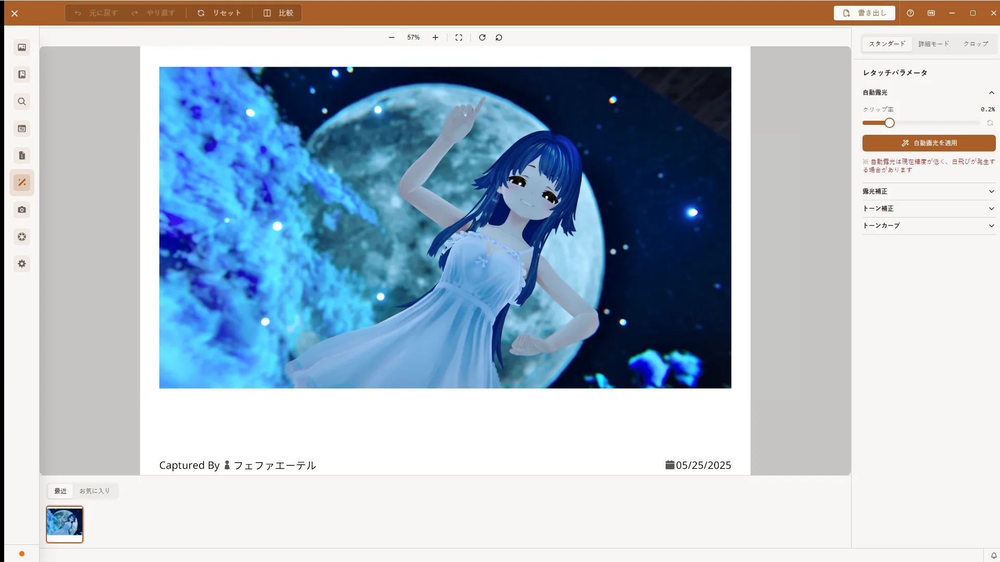

# Retouch Feature Guide

## How to open

Open **Retouch (alpha)** from the sidebar, or open it from a photo's detail view in Gallery.

[🏠 Document Top](../index.md) | [⚖️ Terms of Service](./terms.md) | [🔒 Privacy Policy](./privacy.md)

---

Retouch edits a photo and exports the result as a separate file; it does not overwrite the source. Adjustments are not saved automatically, so use **Export** for any result you want to keep.

## Screen layout

- Center: preview with zoom, fit-to-window, and 90-degree left/right rotation.
- Bottom: a filmstrip with **Recent** and **Favorites** sources. Recent photos load more when you reach the end.
- Right: adjustment panel with **Standard**, **Advanced**, and **Crop** tabs.
- Title bar: **Undo**, **Redo**, **Reset**, and **Export**.

## Compare Photos

Select two or more photos from the filmstrip to enter comparison (up to four). With one photo selected, click **Compare** in the title bar to include its adjacent photo.

In comparison, toggle **Before/After** for each photo. When comparing two photos, switch between side-by-side and top/bottom layouts. Use **Apply target** to choose all comparison photos or only the focused photo. Click **Back** to leave comparison; if you made edits, choose whether to keep or discard them.

## Standard tab

### Auto exposure

Click **Apply Auto Exposure** to analyze the preview and adjust exposure compensation, black level, Lightness, highlight compression, and contrast. Set the clip percentage first if needed. The current implementation is low-accuracy and may clip highlights.

### Manual adjustments

- **Exposure Compensation**: EV-based brightness correction
- **Black Level / Lightness**: dark tones and overall brightness
- **Highlight Compression**: reduce bright-area clipping
- **Brightness / Contrast / Saturation**
- **Color Temperature**: cool-to-warm adjustment (displayed as -100 to +100)
- **Highlights / Shadows**

Each row supports a slider and a numeric field. Use the reset icon on a row to restore that parameter's default.

### Tone curve

Choose the RGB, R, G, or B channel, click the curve to add a control point, drag points to move them, and right-click to remove a point.

## Advanced tab

The Advanced tab provides accordion sections for:

- **HSL adjustments**: hue, saturation, and luminance for red, orange, yellow, green, aqua, blue, purple, and magenta
- **Sharpness**
- **Noise reduction**: luminance and color
- **Vignette**: strength, size, and feather
- **Color grading**: shadows, midtones, and highlights
- **Monochrome**: enable it and adjust RGB weights

### Film Look

Open **Film Look** in Advanced to choose a look and amount, then adjust grain strength, density, and size. Use **Import .cube** to add a 3D LUT. The current screenshot may not show these controls.

## Crop and rotation

1. In the **Crop** tab, choose **Specify crop area**.
2. Drag the crop area on the preview to move or resize it.
3. If needed, choose **Free / Original / 1:1 / 4:3 / 3:2 / 16:9 / 9:16 / 4:5**.
4. Use **Clear crop** to remove the range.

The range is committed as you drag; there is no separate **Apply** button. The selected range is included in the export. Rotate with the 90-degree buttons below the preview; rotation is part of the edit history.

## Export

Click **Export** in the title bar and choose a format and preset:

- Format: **JPEG** or **PNG**
- **Original**: export at the original resolution
- **For X**: a local image-export size preset that fits within 1920×1080 px
- **For VRChat website**: set the maximum long side (640–8192 px)

Confirm the destination and filename to save a separate file. The output folder opens after a successful export. The dialog cannot be closed while export is running.

## EXIF Studio (camera info frames)

Open **EXIF Studio (beta)** from the sidebar to create a camera-information frame below a photo. Use the Recent/Favorites filmstrip and live preview. The available controls include:

- Save EXIF presets, and apply, delete, or reorder presets you saved
- Layout (Default: split / Simple: single column), text alignment, font, and color theme
- Border width, bottom-bar height, and font size
- Camera type, aperture, focal length, world name, and photographer visibility
- Watermark visibility, position, text, size, and opacity

EXIF Studio also has JPEG/PNG export and the same export presets.

Choose **Auto**, **Landscape**, **Square**, or **Portrait** from the template controls. **Auto** adjusts the layout to the photo's aspect ratio. Templates set the layout, text alignment, border width, and bottom-bar height while keeping other settings, such as camera information and watermark, as currently configured. Adjust the remaining controls as needed and save your configuration as an EXIF preset.

## Notes

- Retouch adjustments are not auto-saved; export anything you want to keep.
- The original photo file is not modified.

## Related documentation

- [Gallery Guide](gallery-guide.md) - Photo selection and detail sidebar
- [Settings Guide](settings-guide.md) - Application-wide settings
