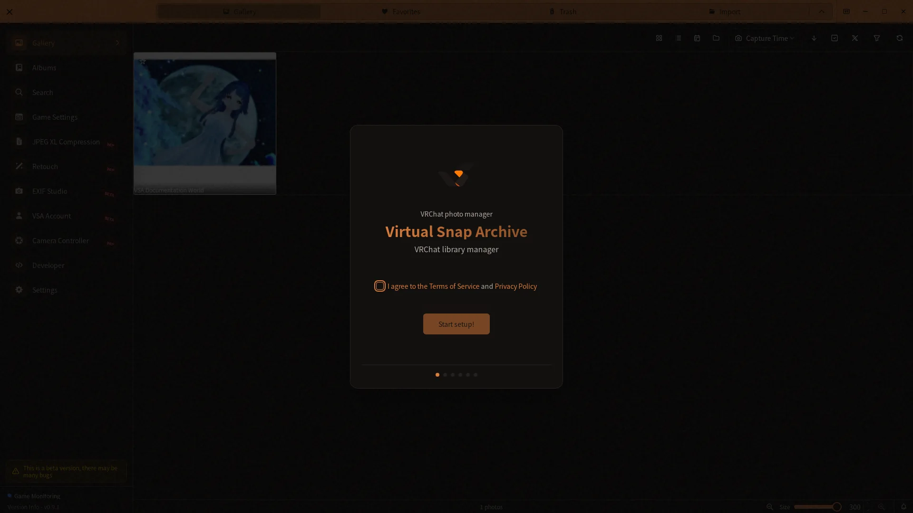

# Initial Setup Guide

## How to open

The setup wizard appears when VSA starts for the first time.



[🏠 Document Top](../index.md) | [⚖️ Terms of Service](./terms.md) | [🔒 Privacy Policy](./privacy.md)

---


When you launch the VSA app for the first time, the setup wizard appears. This guide explains each step of the setup wizard in detail.

## Setup Wizard Overview

The setup wizard supports basic configuration when using VSA for the first time.

**Time Required**: 2-5 minutes

**When Wizard Appears**:
- When launching VSA for the first time
- After enabling Developer Mode in Settings > System and resetting setup from the Developer menu

## Setup Steps

### Step 1: Welcome Screen

An introduction page for the VSA application.

**Display Contents**:
- VSA logo and product name
- Brief description
- Main features of VSA

**Description Includes**:
- VRChat photo management
- JPEG XL compression feature
- Automatic metadata extraction

**Operations**:
- "Next" button: Proceed to next step

### Step 2: Language and Theme Selection

Select the app display language and visual theme.

#### Language Settings

**Options**:
- **Japanese**: Most of the interface appears in Japanese.
- **English**: Most of the interface appears in English. In-app tutorials are currently shown in Japanese.

**How to Select**:
1. Select language from radio button or dropdown
2. Selection may be applied immediately

**Change Later**:
- Can be changed in Settings > Appearance > Language Settings

#### Theme Settings

**Theme Modes**:
- **Light**: Bright color scheme (recommended for bright environments)
- **Dark**: Dark color scheme (reduces eye strain)
- **System**: Auto-follow Windows settings (recommended)

**How to Select**:
1. Select theme mode
2. Appearance changes immediately in preview

**Change Later**:
- Can be changed in Settings > Appearance > Theme Settings

#### Theme Color Selector

Select the accent color for the app.

**3 Color Presets**:
- **Darkroom**: Graphite and amber
- **Night Scene**: Blue-black and cobalt
- **Print**: Warm white and teal ink

**How to Select**:
1. Click desired color
2. App accent colors change

**Change Later**:
- Can be changed in Settings > Appearance > Theme Color Selector

### Step 3: Folder Settings

Specify the VRChat screenshot folder.

- Choose whether to organize photos into monthly subfolders.
- Choose whether to import existing photos now or only handle new photos going forward.
- Enable **Change output folder** to select a separate destination for processed photos. When disabled, VSA uses the VRChat folder.

#### Screenshot Folder Setting

Specify the folder where VRChat saves photos.

**Default Path**:
```
C:\Users\[Username]\Pictures\VRChat
```

**How to Set**:
1. Click "Select Folder" button
2. Folder selection dialog opens
3. Select VRChat photo folder
4. Click "Select Folder"

**How to Verify**:
- Path is displayed
- Confirm path is correct

**VRChat Default Folder Location**:
```
Windows: C:\Users\[Username]\Pictures\VRChat
```

#### If Folder Not Found

**Steps**:
1. Open Windows Explorer
2. Manually open `C:\Users\[Username]\Pictures\`
3. Check if `VRChat` folder exists

**If VRChat Not Yet Launched**:
- Launch VRChat and take one screenshot
- `Pictures\VRChat` folder will be auto-created

**If Using Custom Folder**:
1. Click "Select Folder" in wizard
2. Select custom folder configured in VRChat
3. Click "Select Folder"

### Step 4: Additional Folders

If photos are stored outside the VRChat output folder, you can register additional import folders. Existing images start importing when a folder is added. Continue without adding one if it is not needed.

### Step 5: Startup Method

Choose whether VSA should start automatically when you sign in to Windows. You can change this later in Settings > System.

**Options**:
- **Start when Windows signs in**: Keeps VSA resident in the background after Windows login.

**How to Select**:
1. Turn on the switch if you want VSA to start at Windows sign-in.

**Change Later**:
- Windows startup: Settings > System
- Steam integration: [Game Settings](game-config.md) > Plugins

### Step 6: JXL Archive and Complete

To store older photos as reversible JXL files, enable automatic archiving and select an age threshold (1, 2, 3, 4, 6, or 12 months). The read-only archive destination follows the current photo output folder as its `VSA-Archive` subfolder. Leave it disabled if you do not want to use it.

Setup is complete and move to main screen.

**Completion Screen**:
- Confirm settings
- "Complete" button

**After Completion**:
1. Click "Complete"
2. Main screen appears
3. Gallery view displays
4. VSA performs the selected migration and import while showing counts, percentage, and the current file
5. If finalization fails, completed work is kept and you can close setup or return to Folder Settings

## Re-running Setup

To redo setup:

### Method 1: Reset from the Developer Menu

**Steps**:
1. Enable Developer Mode in Settings > System
2. Open **Developer** from the sidebar
3. In the Reset section, reset **Setup wizard**
4. Restart VSA

Do not delete or replace settings files manually.

## Troubleshooting

### Setup Won't Complete

**Symptom**: Wizard won't progress or becomes unresponsive

**Causes and Solutions**:

**App Not Responding**:
1. Ctrl + Alt + Delete
2. Open Task Manager
3. Select VSA process
4. Click "End Task"
5. Restart VSA

**Insufficient Disk Space**:
1. Check disk space
2. Delete unnecessary files
3. Ensure several GB of free space
4. Restart VSA

**"Next" Button Unresponsive During Wizard**:
1. Click mouse again
2. Press keyboard Enter key
3. Click different button
4. Check if responsive

### Can't Select Folder

**Symptom**: Dialog doesn't appear when trying to select folder

**Causes and Solutions**:

**Dialog hidden behind another window**:
1. Check behind VSA and other windows for the folder picker
2. If it is not there, restart VSA and try selecting the folder again

**Folder Access Permissions**:
1. Right-click target folder
2. Open Properties
3. Check Security tab permissions
4. Confirm Read permission exists

### VRChat Folder Not Found

**Symptom**: Can't find VRChat folder despite installation

**Verification Steps**:

**Actual VRChat Installation**:
1. Confirm VRChat is actually installed
2. Launch VRChat and take one screenshot
3. After screenshot, check `Pictures\VRChat` folder

**Folder Display Settings**:
1. Open Windows Explorer
2. Enable "Show hidden files" from View tab
3. Check if hidden folders display

**If Using Custom Folder**:
1. Check custom output folder in VRChat settings
2. Specify that folder in wizard

## Best Practices

### Setup Tips

**Language Settings**:
- Select language you understand well
- Use the corresponding language version of the guides as needed

**Theme Selection**:
- Recommended: "System" to match Windows settings
- Auto-switches based on environment and time

**Folder Settings**:
- If not default folder, check VRChat settings
- If using multiple folders, specify main folder

**Auto-Launch Setting**:
- Enable if you want VSA resident after Windows sign-in
- Disable if you do not want it to start automatically

## After Setup

After completing setup, recommend these steps:

1. **Check Gallery**: Verify imported photos
2. **Check Metadata**: Confirm world name and usernames display in photo details
3. **Verify Game Settings**: See [Game Settings Guide](game-config.md) for watch folders, logs, OSC, and plugins

## Related Documentation

- [Basic Usage](../basic-usage.md) - Overall VSA usage
- [Game Settings Guide](game-config.md) - Detailed VRChat integration settings
- [Settings Guide](settings-guide.md) - Detailed settings options
- [Troubleshooting Guide](troubleshooting.md) - If problems occur
