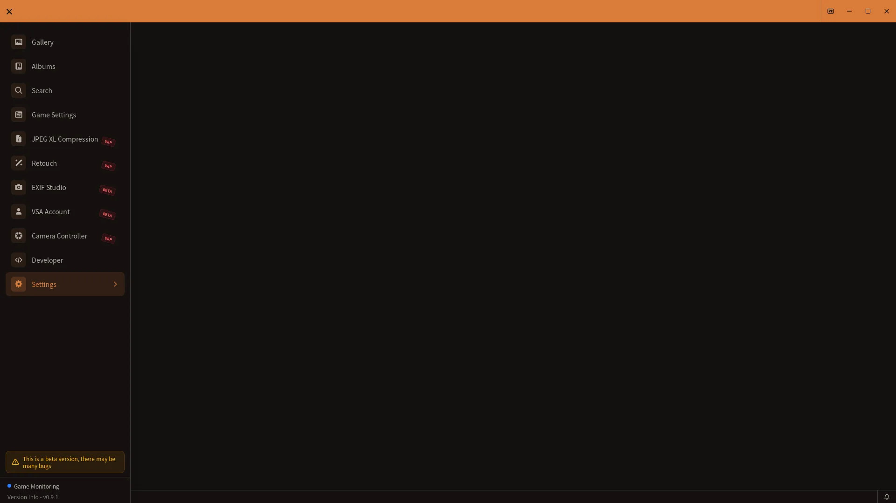

# VRChat Integration

## How to open

Open **Game Settings** from the sidebar. Folder and OSC options are in the **Display Settings** tab.



[🏠 Document Top](../index.md) | [⚖️ Terms of Service](./terms.md) | [🔒 Privacy Policy](./privacy.md)

---


VSA automatically extracts and saves metadata from photos taken in VRChat. This guide explains the metadata VSA saves and how it works.

> **Note (Integral parameters)**
> Integral is supported, but some camera parameter values may not be recorded or displayed correctly.

## Metadata Overview

When you take a photo in VRChat, VSA automatically embeds the following information into the PNG image.

- World information
- User information
- Camera parameters
- Capture time

This information is saved as PNG metadata and can be read by compatible tools without using VSA.

## World Information

Information about the world you were in when the photo was taken is recorded.

| Item | Description | Example |
|------|-------------|---------|
| World Name | VRChat world name | "Japan Shrine" |
| World ID | VRChat internal ID | "wrld_xxx..." |
| Instance ID | Instance identifier | "12345~hidden(usr_xxx)" |
| Instance Type | Access permissions | Public, Friends+, Friends, Invite+, InviteOnly |

## User Information

User information at the time of capture is recorded.

| Item | Description |
|------|-------------|
| Photographer Name | Username of the person who took the photo |
| Photographer ID | VRChat user ID (usr_xxx format) |
| Participants List | All usernames in the instance |

The participants list includes the usernames of everyone who was in the instance at the time of capture.

## Camera Parameters

The captured camera type and OSC parameters are recorded when available. The fields depend on the camera, avatar, and OSC state at capture time.

### VirtualLens2

Parameters recorded when using VirtualLens2:

| Parameter | Description |
|-----------|-------------|
| Aperture | Aperture value; the avatar's minimum and maximum may also be shown |
| Focal Length | Focal length |
| Exposure | Exposure compensation |

### Integral

Parameters recorded when using Integral:

| Parameter | Description |
|-----------|-------------|
| Aperture | F-stop value |
| Focal Length | Focal length |
| Exposure | Exposure compensation |
| Shutter Speed | Shutter speed |
| Bokeh Shape | Bokeh shape |

If focus, aberration, composition, or other values were saved, the photo detail's Integral section shows them as additional rows.

### FishEye / TelePortraitLens

Both are controllable from Camera Controller. When a TelePortraitLens snapshot is stored, the photo detail shows a dedicated section. FishEye is currently focused on controller operation and has no dedicated photo-detail section.

### Normal Camera

For the standard VRChat camera, VSA records and displays only parameters it can confirm over OSC at capture time. Unconfirmed values are not included, and available fields depend on what OSC provides.

## How OSC Communication Works

VSA communicates with VRChat using the OSC (Open Sound Control) protocol to obtain camera settings.

### How It Works

1. Change camera settings in VRChat
2. Camera sends OSC message
3. VSA receives OSC message and saves to memory
4. When photo is taken, saved camera settings are embedded in the image

### Required Settings

To enable OSC communication:

1. Enable OSC in VRChat settings
2. Enable OSC output on the camera you use

## VRChat Log Analysis

World and user information is extracted from VRChat log files.

### Log File Location

```
%LOCALAPPDATA%Low\VRChat\VRChat\
```

Usually located at `C:\Users\[Username]\AppData\LocalLow\VRChat\VRChat\`.

### Extracted Information

- World entry/exit
- User join/leave
- Instance information

## Checking Supported Cameras

You can check which camera was used for each photo in the gallery detail view.

- VirtualLens2: Displayed as "VL2" or "VirtualLens2" with aperture, focal length, and exposure rows
- Integral: Displayed as "Integral" with the five base rows and any saved additional values
- TelePortraitLens: Displayed as "TelePortraitLens" with stored snapshot rows
- Normal camera: Displayed as "Normal Camera"

Camera parameters are displayed in accordion format and can be expanded by clicking.

## Related settings

See the [Game Settings Guide](game-config.md) for the settings used by VRChat integration:

- **Display Settings**: Watch, output, and log folders plus OSC
- **Plugins**: Steam, Virtual Desktop, and VRChat outage notifications
- **Time Machine**: Event timeline parsed from VRChat logs

## Troubleshooting

### Metadata Not Being Recorded

1. **Check if OSC is enabled in VRChat**
   - VRChat Settings > OSC > Enable

2. **Check if using a supported camera**
   - Use VirtualLens2, Integral, FishEye, or TelePortraitLens
   - For the standard camera, only values confirmed over OSC are recorded. Values VSA cannot receive are not displayed

3. **Check if VSA is running in the background**
   - VSA must be running while VRChat is active

### Missing World/User Information

1. **Check VRChat log files**
   - Verify log files are being output correctly

2. **Check capture timing**
   - Photos taken immediately after entering a world may miss log data

3. **Check the log folder**
   - In Game Settings > Display Settings, verify the **Log folder** points to the folder containing VRChat logs

## Related documentation

- [Game Settings Guide](game-config.md) - VRChat integration settings
- [FAQ](faq.md) - Frequently asked questions
- [Person Search Guide](person-search-guide.md) - Search using photo metadata
