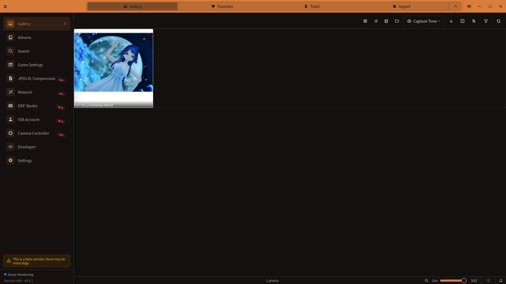

# X Posting Feature Guide

> **Provisional — not generally available.** This page describes the VSA v0.9.0 development build. The features are hidden with normal settings. This page is available by direct URL. Screens and behavior may change.

## How to open

When the cloud UI is available, open the posting modal from Gallery.

This image is a reference from released v0.8.2. The current v0.9.0 development build may look different.

[🏠 Document Top](../index.md) | [⚖️ Terms of Service](./terms.md) | [🔒 Privacy Policy](./privacy.md)

---

X posting is being prepared for general availability. In test environments, you need a signed-in VSA account, a linked X account, and an available posting allowance on your plan. X posting and cloud controls are hidden with normal settings.

## Posting flow

1. Open **Gallery** from the sidebar.
2. Open X posting from a photo's detail sidebar, or use the X-post selection mode to select 1–4 photos.
3. Enter post text. The limit is 280 characters.
4. Optionally use a template and add a camera info frame.
5. Review the preview and usage status, click the post button, and confirm the dialog.

Open Favorites from the **Favorites** tab inside Gallery.

### Before posting

- If you are signed out, use the sign-in prompt in the modal to sign in to your VSA account.
- If the X account is not linked after sign-in, choose **Link X account** and authorize it in the browser.
- The modal shows monthly usage, the limit, and the link status. Posting is blocked after the limit is reached.

### Post text and templates

Edit post text directly in the modal. If saved presets exist, choose **Use template** and select one; you can still edit the inserted text before posting. Templates insert the saved text as-is; variables such as `{world}` are not expanded automatically.

Use **Save as preset** at the bottom of the modal to save the current post text as a new preset.

### Camera info frames

Enable **Add camera info frame** to generate a camera information frame for every selected photo. Detailed layout settings are handled in **EXIF Studio** inside Retouch. The post button waits while frame images are being generated.

Images are optimized when the modal opens. If images over 5 MB are compressed for posting, the modal displays a notice.

## Preset management

The **X Post** panel in Settings manages posting presets:

- **Create**: enter a name and template text; optionally mark it as the default
- **Edit**: change the name, template text, or default flag
- **Delete**: confirm deletion in the dialog

The current panel manages only the name, template text, and default flag. It does not provide hashtag, aspect-ratio, or frame-layout settings.

## Troubleshooting

### The post button is unavailable

Confirm that you are signed in to VSA, that the X account is linked, and that you have posting allowance remaining. Availability can also depend on the staged rollout and your plan.

### Posting fails

Check the network connection and usage status, then retry. Confirm that the post is within 280 characters and that the selected photos can be loaded.

### A camera info frame cannot be added

Check the available photo information in EXIF Studio and try posting without the frame. Wait for frame generation to finish before retrying.

## Related documentation

- [Gallery Guide](gallery-guide.md) — Photo selection and the Favorites tab
- [Settings Guide](settings-guide.md) — X Post preset settings
- [Retouch Guide](retouch-guide.md) — EXIF Studio and camera info frames
