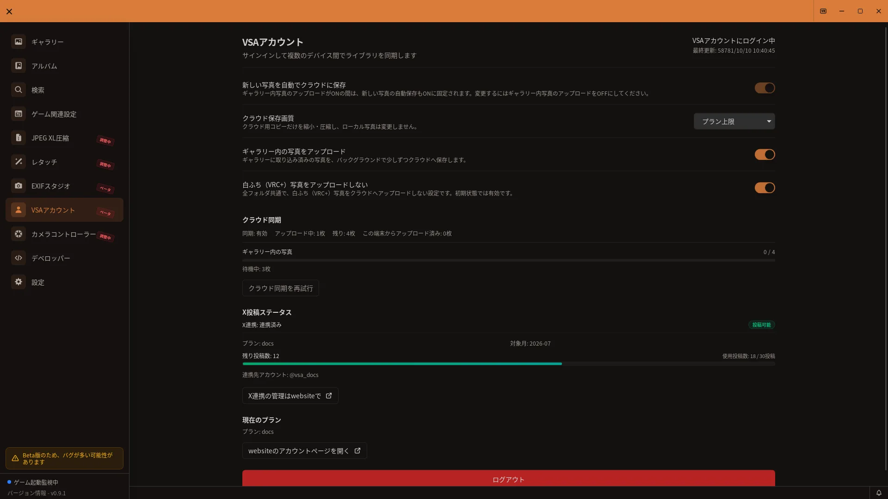

# アカウント管理ガイド

> **準備中・一般向け未公開 — 開発中v0.9.0向けの仮ガイドです。** アカウント画面は通常設定では表示されません。以下は検証対象の環境で画面が表示される場合の説明で、一般提供や公開時期を案内するものではありません。操作や仕様は変更される場合があります。

## 開き方

検証対象の環境で「アカウント」がサイドバーに表示される場合に、その項目を開きます。

画像は配布版の参考表示です。開発中のログイン・バックアップ画面とは異なる場合があります。

[🏠 ドキュメントトップ](../index.md) | [⚖️ 利用規約](./terms.md) | [🔒 プライバシーポリシー](./privacy.md)

---

検証対象のアカウント管理画面では、VSAアカウントの状態確認、クラウド保存・共有リンク・X投稿などの連携機能を設定できます。このガイドは開発中の連携機能の仮説明です。基本的なローカル写真管理にアカウントは必要ありません。

## 概要

アカウント管理では、環境によって以下の操作が利用できる場合があります。

- **VSAアカウント**: サインイン、プラン、連携状態の確認
- **クラウド保存（任意）**: お気に入り等のクラウドバックアップ
- **共有リンク（任意）**: 写真の共有
- **X投稿**: X連携と投稿状況の確認

## アカウント連携機能について（重要）

クラウド保存、共有リンク、X投稿などのアカウント連携機能は**段階的なロールアウト**中です。利用可否は、**公開状況、プラン、アカウント状態、利用環境**により異なります。

アプリに該当メニューやボタンが表示されない場合、その環境ではまだ利用できない可能性があります。具体的な操作は各機能ガイドと**アプリ内の表示・操作**を参照し、料金やデータ取り扱いは以下の正本を参照してください。

- [利用規約](./terms.md)
- [プライバシーポリシー](./privacy.md)

料金、月間上限、無料枠、対象機能の詳細は、ウェブサイトまたはアプリ内表示に従います。固定の超過料金や一律の提供内容を本ドキュメントでは約束しません。

## アカウント管理画面へのアクセス

サイドバーの「アカウント」をクリックして、アカウント管理画面を開きます。

## VSAアカウント

VSAアカウントは、クラウド保存・共有リンク・X投稿などの一部機能で必要になる場合があります。基本的なローカル機能（写真の取り込み、ギャラリー表示、お気に入りのローカル管理など）の利用に、アカウントは必須ではありません。

**一般的な操作**（表示される場合）:

1. アカウント画面を開く
2. 画面の案内に従いサインインまたは連携を行う
3. プラン、連携状態、エラー表示があれば内容を確認する

新しいVSA認証サービスを利用するときは、サイドバーの「アカウント」で「Webサイトでログイン」を選ぶとブラウザーが開き、完了後にアプリのログイン状態が自動更新されます。外部サービス連携では別途ブラウザー認証を行う場合があります。パスワードはVSAに保存されず、認証トークンはローカルに暗号化して保持されます。

### 新しいアカウントで利用する場合

新しい認証サービスを利用する場合は、VSAのWebサイトでアカウントを新規作成し、登録メールに届く確認コードを入力して確認を完了します。旧サービスのアカウント、クラウド写真、共有リンクは新しいアカウントへ自動で引き継がれません。

開発中MainApp v0.9.0の対応環境では、サイドバーの「アカウント」で「Webサイトでログイン」を選び、ブラウザーで新しいアカウントにサインインします。完了するとアプリの状態が自動更新されます。配布済みv0.8.2の操作を示すものではありません。

サインインだけでは、新しい写真のクラウド自動保存や登録済み写真のバックアップは有効になりません。必要な場合は、アカウント画面の「新しい写真を自動でクラウドに保存」と「登録済み写真を自動バックアップ」を個別に有効にしてください。

## クラウド保存とお気に入り

お気に入り機能自体は**ローカル**で利用できます。クラウド保存が利用可能な環境では、アカウント画面またはお気に入り関連のUIから設定できる場合があります。項目名、トグル、手動アップロードの有無はバージョンとロールアウト状態により異なるため、**アプリ内表示に従ってください**。

### アルバムのクラウド保存

ローカルアルバムは必要なものだけクラウド保存を有効にできます。同期中や確認待ちの状態はアルバム画面に表示されます。ローカル側とクラウド側の両方が変更されて競合した場合は、タイトル、公開設定、写真、並び順の差を確認して、どちらを採用するか選べます。

新しいアカウントに保存し直す場合、旧クラウドに接続されたアルバムでアカウント不一致が表示されたら「以前のクラウドとの接続を解除」を選び、確認画面の内容を確認して「接続を解除」を選びます。クラウド側にしかない写真の所属はこの端末のアルバムから取り除かれますが、ローカル写真ファイルとローカルアルバムでの写真の所属は残り、クラウド側のアルバム自体も削除されません。解除後に「クラウドにも保存」を選んで確認すると、新しいアカウントに保存できます。

### 写真の手動アップロード

Free/Liteの手動アップロードは長辺3,840pxまでで、超える画像はアップロード前に4Kへ縮小されます。Plus/Premiumは原画品質に対応します。すべてのプランで、クラウドへ送信する写真は1ファイル64MiB以下です。

ローカルでのお気に入り管理の詳細は[お気に入り機能ガイド](favorites-guide.md)を参照してください。

## 共有リンク

共有リンク機能は段階的に公開されます。利用可能な環境では、写真詳細や共有メニューからリンクを発行できる場合があります。公開範囲、有効期限、料金条件はアプリ内表示と利用規約に従います。

## X投稿連携

X投稿も一般提供の準備中です。検証対象の環境では、アカウント画面にX連携の状態が表示される場合があります。

## プライバシーとセキュリティ

### データの保存場所

- **お気に入り等のローカルデータ**: お使いのPC上（例: `%APPDATA%/VSA/` 配下）に保存されます
- **認証トークン**: ローカルに暗号化して保存され、VSAのみが利用します
- **クラウド保存したデータ**: 利用するクラウドサービスおよびVSAの提供方式に依存します。詳細は[プライバシーポリシー](./privacy.md)を参照してください

### 外部通信

VSAアカウント、クラウド保存、共有リンク、X投稿、アップデート確認、サーバーステータス表示などでは外部通信が発生する場合があります。

## トラブルシューティング

### サインインや連携が完了しない

**症状**: ブラウザで認証したのにアプリに戻らない、またはタイムアウトする

**対策**:

1. ブラウザのポップアップブロックを解除する
2. 別のブラウザで試す（Chrome推奨）
3. インターネット接続とファイアウォール設定を確認する
4. VSAを再起動してから再度試す

### クラウド保存や共有が利用できない

**症状**: メニューが表示されない、または操作が失敗する

**考えられる原因**:

- その環境ではまだロールアウト対象外
- プランやアカウント状態が条件を満たしていない
- ネットワークまたは外部サービスの一時的な障害

**対策**:

1. アプリを最新版に更新する
2. アカウント画面でプランと連携状態を確認する
3. [利用規約](./terms.md)とアプリ内の料金・上限表示を確認する
4. 重要な写真はローカルバックアップを別途取る

### ログアウトや連携解除

アカウント画面に表示されるログアウトまたは連携解除の操作に従ってください。連携解除後は、クラウド保存や共有リンクなどの機能が利用できなくなる場合があります。ローカルの写真やお気に入りデータは通常そのまま残ります。

## ヒント

- **ローカル優先**: クラウド機能の有無にかかわらず、重要な写真はローカルまたは別媒体でバックアップしてください
- **UIを正とする**: ロールアウト中はアプリ内のラベルと利用可能な項目が最も正確です
- **規約の確認**: 料金やデータ取り扱いは利用規約・プライバシーポリシーの正本を参照してください

## 関連情報

- [お気に入り機能ガイド](favorites-guide.md) - ローカルお気に入りとクラウド保存の概要
- [設定画面完全ガイド](settings-guide.md) - アカウント関連設定
- [トラブルシューティング詳細ガイド](troubleshooting.md) - より詳しい問題解決方法
