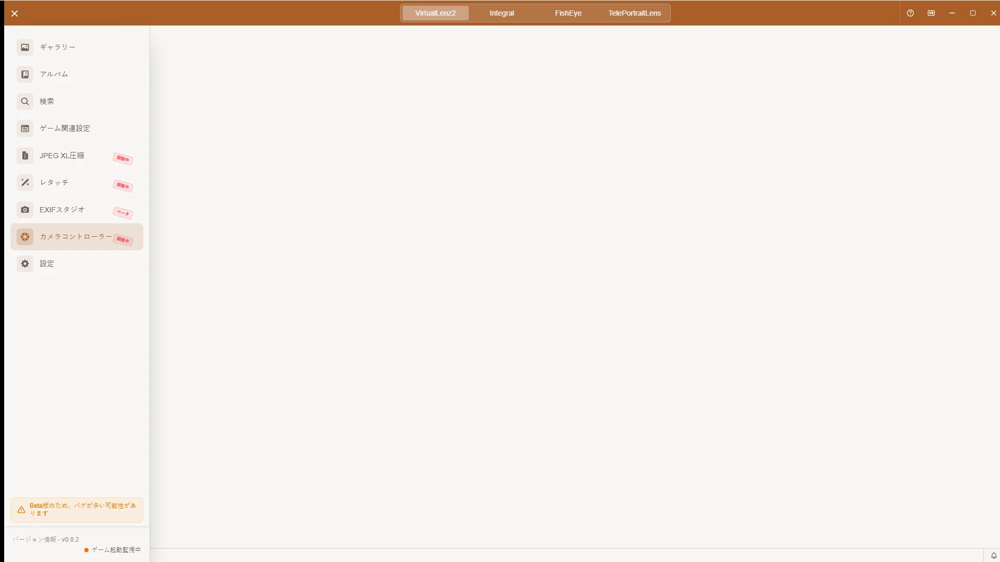

# カメラコントローラーガイド

## 開き方

VSAのサイドバーから「カメラコントローラー」を開きます。



[🏠 ドキュメントトップ](../index.md) | [⚖️ 利用規約](./terms.md) | [🔒 プライバシーポリシー](./privacy.md)

---


カメラコントローラーは、OSC（Open Sound Control）経由でVRChatのカメラパラメータを操作する画面です。画面上部のタブで次のカメラを切り替えます。

- **VirtualLenz2（VirtualLens2）**
- **Integral**
- **FishEye**
- **TelePortraitLens**

## VirtualLens2

VirtualLens2タブでは、レンズ設定とカメラ設定を操作できます。表示される値の範囲は、接続したアバターから取得した値に応じて変わります。

## コントローラー画面へのアクセス

### メニューから開く

**手順**:
1. サイドバーメニュー（左側）を確認
2. 「カメラコントローラー」という項目を探す
3. クリックしてコントローラー画面を開く

### キーボードショートカット

コントローラー専用のショートカットはありません。共通ショートカットは[キーボードショートカット](keyboard-shortcuts.md)を参照してください。

## コントローラー画面の使い方

### 画面構成

VirtualLens2タブは以下のセクションで構成されています：

- **レンズ設定**: 絞り、焦点距離、露出
- **カメラ設定**: AFモード、グリッド、情報表示
- **プリセット**: VirtualLens2用プリセット
- **接続状態**: 接続時のみ表示

### レンズ設定

- **絞り**
- **焦点距離**
- **露出**

各項目はスライダーで調整でき、項目ごとのリセットボタンで既定値に戻せます。値の範囲は接続したアバターから取得した値に応じて変わります。

### カメラ設定

- **AFモード**: 一点AF、顔検出AF、自撮りAF
- **グリッド表示**: なし、3×3、3×3＋対角、6×4
- **情報表示**: カメラ情報表示のオン／オフ

### リアルタイム反映

パラメータを変更すると、接続中のVRChatへOSCで送信されます。VRChatが起動していないとカメラ起動ボタンは操作できません。

**確認方法**:
1. VRChatにてVirtualLens2を装備
2. コントローラー画面でパラメータを調整
3. VRChatの画面（ビューファインダー）で反映を確認

**注意事項**:
- OSC通信が正しく確立されている必要があります

### 対応カメラの操作

- **Integral**: 専用タブでレンズ、フォーカス、シャッター、ボケ、収差、表示設定を操作できます。初期化とカメラ起動／停止を利用できます。
- **FishEye**: レンズの有効化、ぼかしの有効化・量を操作できます。焦点距離、画角、歪み係数は読み取り専用です。
- **TelePortraitLens**: レンズの有効化、Main FOV、前後のボケ、AutoFocus、AutoFocus Dof、WorldFixを操作できます。

## Integral カメラ制御

Integralは、VRChat向けのカメラシステムです。VirtualLens2と同様にコントローラー画面から操作できます。

### Integralコントローラー画面

サイドバーメニューの「カメラコントローラー」から、タブを切り替えることでVirtualLens2とIntegralを使い分けられます。

### 主要なパラメータ

#### レンズ設定

| パラメータ | 範囲 | 説明 |
|-----------|------|------|
| **絞り（Aperture）** | 0.0 ～ 1.0 | ボケの強さと明るさを制御 |
| **焦点距離（Zoom）** | 0.0 ～ 1.0 | カメラのズームレベル |
| **露出（Exposure）** | 0.0 ～ 1.0 | 画像全体の明るさ調整 |

#### フォーカス制御

| パラメータ | 説明 |
|-----------|------|
| **フォーカスモード** | MF（マニュアル）/ AF（オートフォーカス）/ ビジュアルAF |
| **フォーカス値** | フォーカス位置をマニュアル調整 |
| **AFポーズ** | オートフォーカス機能を一時停止 |

#### ボケ形状（Bokeh）

Integralのボケ形状を選択できます：

| 形状 | 説明 |
|------|------|
| **円形（Circle）** | 自然で上品なボケ（デフォルト） |
| **六角形（Hexagon）** | 幾何学模様のボケ |
| **星形（Star）** | キラキラした光の効果 |
| **ハート形（Heart）** | 可愛らしい演出向け |
| **バブル（Bubble）** | 泡のような透明感 |

**ボケ形状回転**: ボケ形状を回転させて角度を調整できます。

#### シャッター制御

| パラメータ | 説明 |
|-----------|------|
| **シャッタースピード** | 露出時間の基本値 |
| **シャッタースピード追加値** | 微調整用の追加値 |
| **ローリングシャッター** | フィルムカメラのシャッター効果（OFF / 左→右 / 上→下 など） |

#### レンズ効果

| 効果 | 説明 |
|-----|------|
| **ビネット（Vignetting）** | 周辺光量落ち効果 |
| **絞り形状比** | 絞りの縦横比を調整 |
| **色収差（Chromatic Aberration）** | レンズの色分散効果 |
| **球面収差（Spherical Aberration）** | レンズ特性の再現 |

#### 特殊フィルター

**クロスフィルター**: 光の十字効果を追加
- **ウェイト**: フィルター効果の強さ
- **スケール**: 十字の大きさ
- **角度**: 十字の回転角度
- **波の振幅／周波数**: 光の波打ち方を調整
- **形状**: 2／4／6／8本の線数を選択

#### チルト（Tilt Shift）

X / Y 方向にレンズを傾けて、特殊な焦点効果を実現します。

#### 合成モード

画像処理アルゴリズムを選択：

| モード | 説明 |
|--------|------|
| **通常（Normal）** | 標準的な画像処理 |
| **ライテン（Lighten）** | 明るい領域を重視 |
| **比較明(S)** | 比較明の単発モード |
| **ダーケン（Darken）** | 暗い領域を重視 |
| **比較暗(S)** | 比較暗の単発モード |
| **深度（Depth）** | 深度情報を利用 |
| **ディザー（Dither）** | ディザ処理 |
| **映画（Movie）** | フィルム風処理 |

#### カーブ / LUT

- **カーブ**: Linear、Log、LUT1、LUT2、LUT3
- **LUT Mix**: LUT効果の混合量

#### その他の機能

| 機能 | 説明 |
|------|------|
| **グリッド表示** | 構図ガイド表示 |
| **ヒストグラム** | 露出確認 |
| **セルフィモード** | 前向きカメラモード |
| **自動レベル** | Off / R / Up / L |

次の項目も表示／その他のカードから操作できます。

- **FixMode**: World / Avatar
- **FixWhileOpen**: 露光中の固定
- **Timer**: タイマー撮影
- **Screen Info／Screen Font Size**: 画面情報と文字サイズ
- **HUD**: ヘッドアップディスプレイ
- **Layer**: Local Player、Remote Player、UIの表示切り替え

---

## OSC通信設定

### OSCとは

OSC（Open Sound Control）は、ネットワークを通じてリアルタイムにパラメータを送受信するプロトコルです。VRChatとVSAの間で数値データを交換します。

### ポート設定

#### デフォルトポート

ゲーム関連設定の既定値は、VSA受信（VRChat送信）`9001`、VSA送信（VRChat受信）`9000`です。

#### ポート番号の変更

**変更が必要な場合**:
- ポート9001が別のアプリケーションで使用されている場合
- ネットワーク環境の要件で別のポートを指定する必要がある場合

**変更手順**:
1. サイドバーのゲーム関連設定 > 画面設定を開く
2. 「VSA受信ポート（VRChat送信）」または「VSA送信ポート（VRChat受信）」を変更
3. VRChat側の対応する送信先・受信側ポートも確認

コントローラー画面にはポート設定欄はありません。変更はゲーム関連設定に反映されます。

### 通信状態の確認

#### ステータス表示

コントローラー画面に通信状態が表示されます：

- **接続中（緑色）**: VRChatと正常に通信しています
- 接続できない場合は「接続中」が表示されません

#### 診断方法

**手順**:
1. VRChatでVirtualLens2を装備
2. コントローラー画面を開く
3. ステータスが「接続中」になるまで待機
4. パラメータを1つ変更してみて、VRChatに反映するか確認

## プリセット管理

プリセットはVirtualLens2タブの設定（絞り、焦点距離、露出、AFモード、グリッド、情報表示）を保存します。Integral、FishEye、TelePortraitLensにはこのプリセット欄はありません。

### プリセットとは

よく使うパラメータ設定（焦点距離、絞り、露出など）を組み合わせたセットをプリセットとして保存できます。

### プリセットの保存

**手順**:
1. 各パラメータを目的の値に調整
2. 「プリセット」セクションで「保存」ボタンをクリック
3. プリセット名を入力（例：「ポートレート」、「広角」）
4. 「保存」をクリック

### プリセットの読み込み

**手順**:
1. 「プリセット」セクションでプリセット名のボタンをクリック
2. 保存されたパラメータ値がすべて適用されます
3. VRChatに自動的に反映されます

### プリセットの削除

**手順**:
1. 削除したいプリセットを選択
2. 「削除」ボタンをクリック
3. 確認ダイアログで「削除」をクリック

## VRChat側の設定

### VirtualLens2アバターの装備

VirtualLens2を操作するには、VRChat内でVirtualLens2カメラが搭載されたアバターを装備する必要があります。

**確認方法**:
1. VRChatでアバターを装備
2. 表示 > ビューファインダー でVirtualLens2ビューファインダーが表示されるか確認

### OSCの有効化（VRChat側）

**VRChat設定手順**:
1. VRChatを起動
2. VRChatのOSC設定を開く
3. 「OSCを有効にする」をチェック
4. VSA受信ポート（既定: 9001）とVSA送信ポート（既定: 9000）に対応する設定を確認

### VirtualLens2パラメータの確認

VirtualLens2タブが扱う主なOSCパラメータは次のとおりです：

- `/avatar/parameters/VirtualLens2_Zoom` - 焦点距離
- `/avatar/parameters/VirtualLens2_Aperture` - 絞り
- `/avatar/parameters/VirtualLens2_Exposure` - 露出
- `/avatar/parameters/VirtualLens2_AFMode` - AFモード
- `/avatar/parameters/VirtualLens2_Grid` - グリッド
- `/avatar/parameters/VirtualLens2_Information` - 情報表示

アバター側のパラメータ名や値域は、使用するVirtualLens2アバターの説明に従って確認してください。

## トラブルシューティング

### OSC通信が接続されない場合

**症状**: ステータスが「切断」のままになっている

**解決方法**:
1. VRChat側のOSC設定を確認
   - 「OSCを有効にする」がチェックされているか確認
   - VSA受信9001／VSA送信9000（または変更後の対応する値）を確認
2. ファイアウォール設定を確認
   - Windowsファイアウォールが通信をブロックしていないか確認
   - セキュリティソフトの設定を確認
3. ポート番号が使用中でないか確認
   ```
   netstat -ano | findstr ":9001 :9000"
   ```
   - 他のプロセスがそのポート番号を使用している場合、別のポート番号に変更してください
4. VRChatとVSAを再起動
   - 両方とも完全に終了して再起動してください

### パラメータが反映されない場合

**症状**: コントローラーで値を変更しても、VRChat内で反映されない

**解決方法**:
1. 通信状態を確認
   - コントローラー画面のステータスが「接続中」か確認
   - 通信が「切断」の場合は上記の「OSC通信が接続されない場合」の解決方法を参照
2. VirtualLens2の装備を確認
   - VRChat内で正しいアバターを装備しているか確認
   - VirtualLens2ビューファインダーが表示されているか確認
3. パラメータ名を確認
   - アバター側で正しいパラメータ名が設定されているか確認
4. VSAを再起動
   - OSC接続をリセットするため、VSAを完全に再起動

### パラメータの反応が遅い場合

**症状**: コントローラーで値を変更してもVRChatに反映されるまでに遅延がある

**解決方法**:
1. VSAとVRChatが同じPCで起動しているか確認
2. 他のアプリケーションの負荷を確認
   - CPU使用率が高くないか確認
3. VRChat側の処理負荷を確認
   - インスタンス内のプレイヤー数が多い場合、パフォーマンスが低下する可能性があります

### パラメータリセットが機能しない場合

**症状**: リセットボタンをクリックしても値が戻らない

**解決方法**:
1. パラメータの初期値設定を確認
   - リセット対象のパラメータが正しいか確認
2. アバター側の設定を確認
   - VirtualLens2の初期値設定がVRChat側で正しいか確認
3. コントローラーを再起動
   - コントローラー画面を閉じて再度開く

## プリセットの使い方

VirtualLens2の値域は接続アバターによって変わるため、任意の値に調整してから名前を付けて保存し、必要なときに読み込みます。

## 関連ドキュメント

- [VRChat連携](vrchat-integration.md) - VRChat連携の全般情報
- [ゲーム関連設定ガイド](game-config.md) - OSC設定の詳細
- [キーボードショートカット](keyboard-shortcuts.md) - ショートカット一覧
