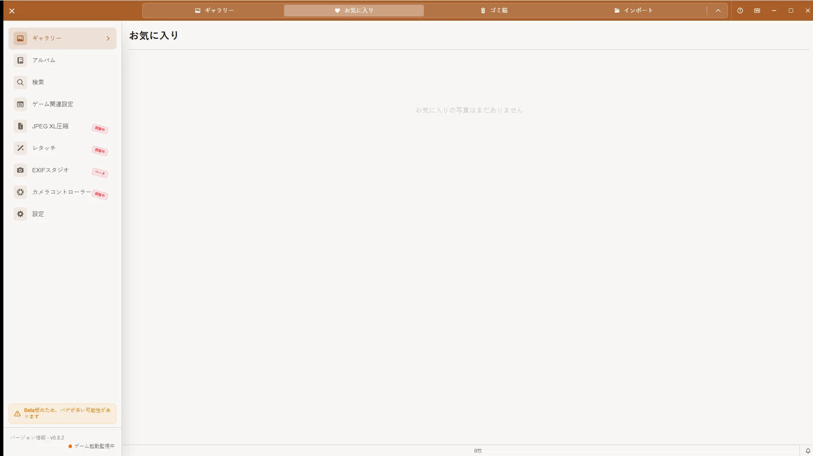

# お気に入り機能ガイド

## 開き方

サイドバーの「ギャラリー」を開き、画面上部の「お気に入り」タブを選択します。

画像は配布済みv0.8.2の参考です。現行の開発版v0.9.0とは表示が異なる場合があります。

[🏠 ドキュメントトップ](../index.md) | [⚖️ 利用規約](./terms.md) | [🔒 プライバシーポリシー](./privacy.md)

---

お気に入り機能を使うことで、大切な写真をローカルで管理できます。お気に入りに登録した写真は、設定したお気に入りフォルダへコピーされます。

## 概要

お気に入り機能では以下のことができます：

- **写真をマーク**: お気に入りの写真に星マークを付ける
- **一元表示**: すべてのお気に入り写真を専用ビューに表示
- **書き出し**: 選択したお気に入りを任意のフォルダへコピー
- **効率的な管理**: 重要な写真を素早くアクセス

## お気に入りの追加方法

### 方法1: ギャラリービューから

ギャラリーのサムネイルに表示される星アイコンをクリックします。

**手順**:
1. ギャラリーを表示
2. 写真のサムネイル右上にある★アイコンを探す
3. ★アイコンをクリック
4. 星が塗りつぶされて「お気に入り登録」完了

### 方法2: 詳細サイドバーから

写真をクリックして表示される詳細情報パネルのボタンをクリックします。

**手順**:
1. ギャラリーから写真をクリック
2. 右側に詳細サイドバーが表示される
3. サイドバーの上部にある★ボタンをクリック
4. 星が塗りつぶされてお気に入り登録完了

### 方法3: テーブル表示から

テーブル表示での各行の★列をクリックします。

**手順**:
1. テーブル表示に切り替え
2. 対象行の★列をクリック
3. お気に入り登録完了

**ヒント**: グリッド表示とテーブル表示の両方で同じお気に入り状態が同期されます。

## お気に入りビューの使い方

### アクセス方法

サイドバーの「ギャラリー」を開き、画面上部の「お気に入り」タブを選択して専用ビューを開きます。

### 表示方法

お気に入りビューには、登録したすべての写真がグリッド形式で表示されます。

**表示される情報**:
- サムネイル画像
- 写真メタデータ（ホバー時に表示）
- 撮影日時
- ワールド名

### 選択モードと一括操作

お気に入り画面の「選択モード」から複数の写真を選択できます。選択後は「すべて選択」「キャンセル」「選択した写真を書き出す」「選択を削除」が使えます。書き出し先は操作ごとにフォルダを選択します。

### 削除機能

お気に入りから写真を削除します。

**手順**:
1. 個別に解除する写真をクリックします。
2. 詳細サイドバーで★ボタンをもう一度クリックします。
3. 複数の写真をまとめて解除する場合は、選択モードで写真を選び「選択を削除」をクリックします。

**重要**: 詳細サイドバーの★ボタンで個別にお気に入りを解除すると、元の写真はギャラリーに残り、VSAが記録しているお気に入りフォルダのコピーは削除されます。一方、選択モードで「選択を削除」を実行した場合は、お気に入り状態だけが解除され、元の写真とお気に入りフォルダのコピーは残ります。

## データ管理

### お気に入りフォルダ

お気に入りの保存先は、設定画面の**お気に入り**パネルで選択できます。フォルダを設定すると、写真をお気に入りに登録した時点で元画像のコピーが作成されます。詳細サイドバーの★ボタンで個別に解除すると、VSAが記録しているコピーも削除されます。選択モードで一括解除した場合、コピーは残ります。

保存先を変更した後に、既存のお気に入りを新しいフォルダへコピーする場合は、同じパネルの「お気に入り画像を移行」を実行してください。移行結果には成功・失敗件数と失敗した画像の詳細が表示されます。

移行では、現在お気に入りに登録されている写真を選択先へコピーし、移行できた写真のお気に入り状態を解除します。元の写真を削除・整理する前に結果を確認してください。

### 書き出しとバックアップ

お気に入り画面の選択モードから、選択した写真を任意のフォルダへ書き出せます。元画像を残したまま別の場所へコピーする操作です。長期保存のためのバックアップでは、VSAを終了してからお気に入りフォルダと元の写真フォルダをコピーしてください。VSAの管理データを直接編集・置換しないでください。

## トラブルシューティング

### お気に入りが保存されない

**症状**: お気に入りに追加しても、再起動後に削除されている

**考えられる原因**:
- ディスク容量不足
- ファイルアクセス権限の問題
- 管理データの破損

**解決方法**:

**ステップ1: ディスク容量を確認**
- Windowsの設定からディスク容量を確認
- 1GB以上の空き容量があるか確認

**ステップ2: アプリを再起動**
- VSAを完全に終了（タスクマネージャーで確認）
- 数秒待機
- VSAを再起動

**ステップ3: ファイルアクセス権限を確認**
- `%APPDATA%/VSA/`フォルダの書き込み権限を確認
- フォルダを右クリック > プロパティで確認

**ステップ4: ログを添えて問い合わせ**
- 設定したお気に入りフォルダの空き容量と書き込み権限を確認
- VSAのログと再現手順を添えて問い合わせる

## プライバシーとセキュリティ

### データ保護

- **お気に入りデータ**: お気に入り状態はVSAがローカルで管理し、コピー画像は設定したフォルダに保存します

## ヒント

- **定期的なバックアップ**: 設定したお気に入りフォルダを定期的にバックアップ
- **オフライン時の操作**: インターネット接続がなくても、ローカルでのお気に入り追加は可能

## 関連情報

- [ギャラリー操作ガイド](gallery-guide.md) - ギャラリー機能の詳細
- [トラブルシューティング詳細ガイド](troubleshooting.md) - より詳しい問題解決方法
