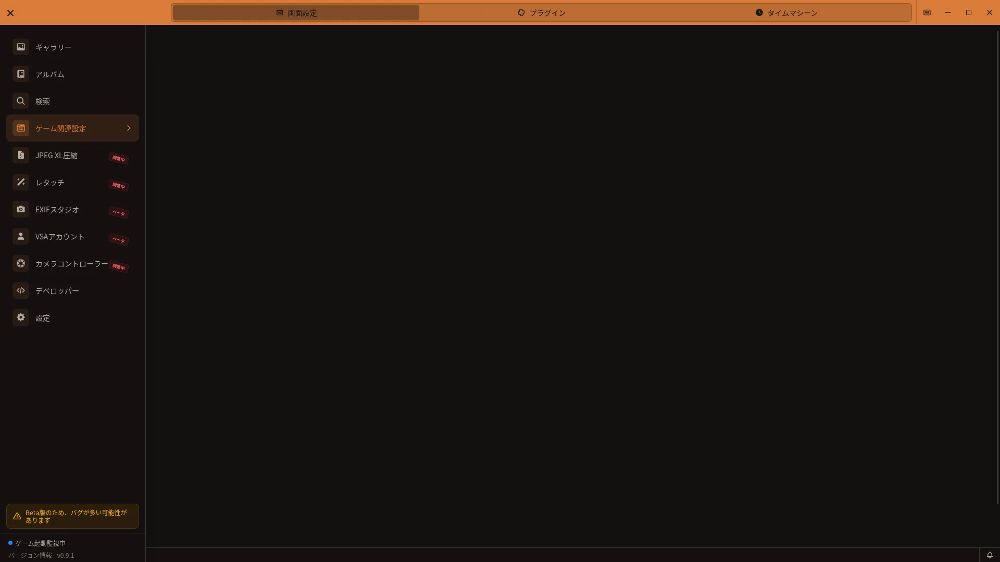

# ゲーム関連設定ガイド

## 開き方

VSAのサイドバーから**ゲーム関連設定**を開きます。



[🏠 ドキュメントトップ](../index.md) | [⚖️ 利用規約](./terms.md) | [🔒 プライバシーポリシー](./privacy.md)

---

ゲーム関連設定では、VRChatの写真取り込み、ログ解析、OSC通信、自動起動プラグインを設定します。設定を変更すると自動的に保存され、保存ボタンを押す必要はありません。設定画面の「ゲーム設定」パネルは画面設定（フォルダとOSC）のみで、3タブの画面はサイドバーから開きます。

> **注意（Integralのパラメータ）**
> Integral関連のカメラパラメータは、現在の実装でも一部の数値が正しく記録・表示されない場合があります。

## タブ構成

画面上部には次の3タブがあります。

- **画面設定**: 監視元・出力先・ログフォルダとOSC
- **プラグイン**: Steam、Virtual Desktop、VRChat障害通知
- **タイムマシーン**: VRChatログのイベントタイムライン

### 監視状態について

現行画面には監視を手動で開始・停止するスイッチはありません。監視はアプリ起動時の設定に従って開始され、サイドバーの状態表示で確認できます。写真を自動で取り込むには、監視元フォルダを設定した状態でVSAを起動しておいてください。

## 画面設定

### フォルダ設定

#### 監視元フォルダ

VRChatがスクリーンショットを保存するフォルダを指定します。**変更**からフォルダを選びます。通常の既定値は次の場所です。

```
C:\Users\[ユーザー名]\Pictures\VRChat
```

VSAはこのフォルダを監視し、新しいゲームスクリーンショットを取り込みます。**監視間隔（秒）**は画面上で1～60秒を指定でき、既定値は10秒です。

#### 出力先フォルダ

**出力先フォルダを変更する**をオンにすると、処理済み写真を監視元とは別の場所へ保存できます。オフの場合は監視元（VRChat）フォルダを使用します。

スイッチをオンにすると選択項目が表示され、出力先を選択した後に設定が有効になります。出力先を選ぶと、監視元にVSA管理下の写真があるか確認するダイアログが表示されます。

- 写真が見つかった場合は**写真も移行**を選ぶと、表示された対象を出力先へ移動します。
- 写真がない場合は**パスだけ変更**を選びます。
- 同名で内容が異なるファイルがある場合、移行中に競合を検出してロールバックを試み、元の写真と設定を保持します。
- 移行中は件数、割合、処理中のファイル名が表示されます。

監視元と同じフォルダ、親子関係にあるフォルダ、存在しないフォルダは出力先に選べません。移行中にキャンセルする操作はありません。

出力先を既定に戻すときは**リセット**を使います。自動JXLアーカイブの保存先は、現在の写真出力先に追従する `VSA-Archive` です。

#### ログフォルダ

VRChatログを読み込むフォルダです。ワールド・ユーザー情報の取得とタイムマシーンのイベント解析に使います。未指定の場合はOSの既定フォルダを使用します。

- **変更**: VRChatのログフォルダを選択
- **リセット**: OSの既定フォルダへ戻す

通常のログフォルダは次の場所です。

```
C:\Users\[ユーザー名]\AppData\LocalLow\VRChat\VRChat
```

### OSC設定

OSC（Open Sound Control）を使うと、VirtualLens2、Integral、FishEye、TelePortraitLensのカメラパラメータを受信できます。

- **OSC通信を有効化**: OSC通信を有効にします。
- **ゲーム起動時にOSCを自動開始**: VRChat検出時にOSCを開始します。OSC通信がオフのときは操作できません。
- **VSA受信ポート（VRChat送信）**: VRChatからVSAへ送るポート。既定値は `9001`。
- **VSA送信ポート（VRChat受信）**: VSAからVRChatへ送るポート。既定値は `9000`。

VRChatの標準ポートはVSA受信 `9001`、VSA送信 `9000` です。別のOSCアプリと競合する場合は両側の対応するポートを変更してください。受信ポートが使用中のときは、VSAが別ポートへ退避して通知する場合があります。

### 自動保存

スイッチは変更直後、数値入力は入力が落ち着いた後に自動保存されます。フォルダ選択や移行の結果は通知で表示され、プラグイン操作の失敗はカード内に表示されます。ゲーム関連設定画面に手動の**設定を保存**ボタンはありません。

## プラグイン

プラグインはカード右側のスイッチで有効・無効を切り替えます。カードをクリックすると現在の状態と詳細を確認できます。利用できない環境や外部設定との競合がある場合は、カードに**要確認**または**利用不可**が表示されます。

### VRChat起動時にVSAを起動（Steam）

SteamからVRChatを起動したときにVSAも起動します。Windows版のSteam VRChat（App ID `438100`）で利用できます。

- 変更前にSteamを終了してください。
- SteamのLaunch OptionsにVSAを追加します。
- Steam側の設定が外部で変更されている場合、VSAは自動的に上書きしません。
- 競合が表示されたときは、Steam側の設定を確認してから再試行してください。

### Virtual Desktop接続時にVRChatを起動

Virtual Desktopとヘッドセットの接続が確立した後、VRChatが起動していない場合にVRChatを起動します。Windowsで利用でき、VSAが起動中である必要があります。

### VRChat障害通知

VRChat公式ステータスを確認し、障害・メンテナンスを通知します。自動確認は5分ごとです。詳細画面では次を設定できます。

- 障害を通知
- 予定または進行中のメンテナンスを通知
- VSA右下のアプリ内トースト通知
- Windows通知センターへのOS通知

詳細には全体ステータス、データ遅延の可能性、最終取得時刻、次回更新、オンラインプレイヤー数、メンテナンス、未解決インシデント、各サーバー状態が表示されます。**手動更新**には60秒のクールダウンがあります。**公式詳細を見る**からVRChatの公式ステータスページを開けます。

## タイムマシーン

VRChatログからイベントの履歴を検索・確認します。ログフォルダが正しく設定されている必要があります。

### 絞り込み

- プリセット: **直近1日／直近1週間／直近1ヶ月／全期間**
- カスタム: 開始日と終了日
- イベントタイプ: **全イベント／ワールド入室／ワールド退出／ユーザー参加／ユーザー退出**
- 検索: ユーザー名、ワールド名、ログの文字列

イベント一覧は時刻、イベントタイプ、ワールド、ユーザーを表示します。ユーザー名をクリックすると、そのユーザーで絞り込めます。**解除**で戻せます。**更新**で再読み込みし、一覧は1ページ50件で前後に移動できます。

## トラブルシューティング

### 写真が自動で取り込まれない

1. **画面設定**で監視元フォルダが実際のVRChatスクリーンショットフォルダか確認します。
2. VSAを起動したまま、サイドバーにフォルダ監視中の状態が表示されるか確認します。
3. 監視間隔（画面上は1～60秒）を確認し、指定フォルダに新しい画像が作成されているか確認します。
4. フォルダの読み取り権限と、VSAがセキュリティソフトでブロックされていないか確認します。

### ワールド名やユーザー名が表示されない／タイムラインが空

1. **画面設定 > ログフォルダ**を確認し、VRChatログが存在する場所を指定します。
2. VRChatでワールド移動やユーザー参加が記録された後、新しい写真またはタイムラインを確認します。
3. ログがない場合はVRChatを起動して一度ワールドへ移動し、ログが作成されるか確認します。

### OSCのカメラ情報が取得できない

1. **OSC通信を有効化**をオンにします。
2. VRChat側のOSCを有効にし、VSA受信 `9001`／VSA送信 `9000`（または変更後の対応する値）を確認します。
3. 使用するカメラ（VirtualLens2、Integral、FishEye、TelePortraitLens）のOSC出力を有効にします。
4. ポート競合やファイアウォールを確認します。VSAが受信ポートを退避した通知を表示していないかも確認してください。

### Steamプラグインを変更できない

Steamを完全に終了してから再試行します。カードが**要確認**の場合は、SteamのVRChatプロパティにあるLaunch Optionsを確認し、別アプリのwrapperや引数を残したままVSAの部分だけを調整してください。

### サーバー状態が更新されない

ネットワーク接続を確認し、手動更新を試します。手動更新直後は60秒間再実行できません。データ遅延の可能性が表示される場合は、公式ステータスページも確認してください。

## 関連情報

- [VRChat連携ガイド](vrchat-integration.md) - メタデータとOSCの仕組み
- [JXL圧縮ガイド](jxl-compression.md) - 自動アーカイブ
- [設定画面完全ガイド](settings-guide.md) - 設定パネル全体
- [初回セットアップガイド](setup-wizard.md) - 初回のフォルダ・起動設定
- [トラブルシューティング詳細ガイド](troubleshooting.md)
- [FAQ](faq.md)
