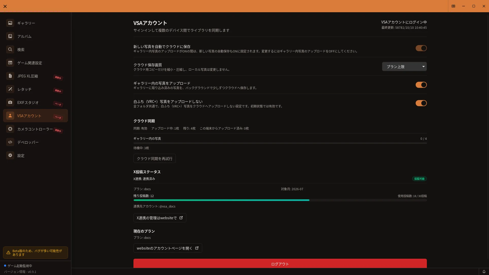

# クラウド連携ガイド

> 準備中・一般向け未公開です。開発中のVSA v0.9.0向けページで、通常設定には表示されません。直接URLから閲覧できます。画面と仕様は変更される可能性があります。

## 開き方

検証対象の環境で連携機能が表示される場合に、サイドバーの「アカウント」または「アルバム」を開きます。通常設定ではこれらのクラウド操作は表示されません。

画像は配布済みv0.8.2の参考です。現行の開発版v0.9.0とは表示が異なる場合があります。

[🏠 ドキュメントトップ](../index.md) | [⚖️ 利用規約](./terms.md) | [🔒 プライバシーポリシー](./privacy.md)

---

## アカウント連携

アカウント画面や連携機能が利用できる環境では、画面の案内に沿ってサインインし、連携状態を確認します。認証方法や表示内容はバージョンによって変わることがあります。現在の画面と規約・プライバシーポリシーを確認してください。

## アルバムのクラウド操作

クラウド機能が表示されている場合、アルバム画面から操作できます。

1. クラウド一覧ではアルバムを閲覧できます。一覧から選び、ローカルへ取り込むと、この端末のアルバムとして使えます。
2. ローカルアルバムをクラウドにも保存するには、対象アルバムを開いて「クラウドにも保存」を選び、確認します。
3. 接続済みアルバムでは同期の一時停止・再開を選べます。端末とクラウドの両方に変更がある場合は「競合を確認」から内容を比べて使う版を選びます。

クラウド一覧は閲覧用です。アルバムや写真をこの端末から削除する操作と、クラウド側の操作は画面の確認内容を読んで選んでください。

## お気に入りのクラウド同期

お気に入りの登録や書き出しは、クラウド機能が表示されない場合もローカルで利用できます。アカウント連携による同期が利用できる環境では、同期状態や再試行など、画面に表示される操作に従ってください。お気に入り画面での操作は、写真の選択、書き出し、お気に入り解除です。

提供状況、料金、利用上限は固定せず、アプリ内の表示と[利用規約](./terms.md)を確認してください。データの取り扱いは[プライバシーポリシー](./privacy.md)を参照してください。
