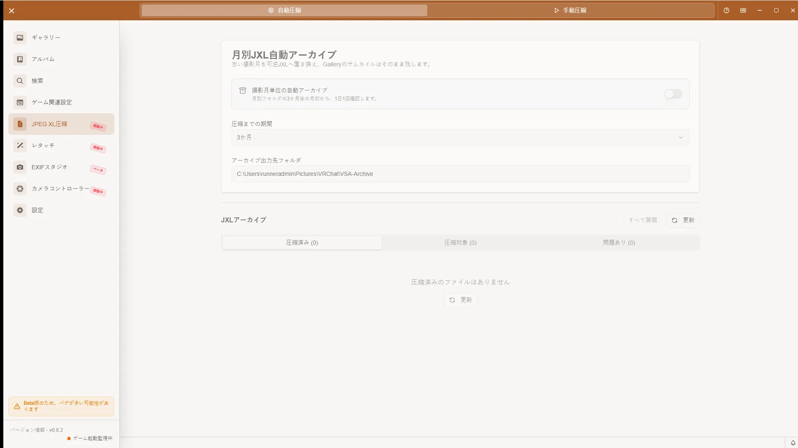

# JXL圧縮ガイド

## 開き方

VSAのサイドバーから「JXL圧縮」を開きます。

[🏠 ドキュメントトップ](../index.md) | [⚖️ 利用規約](./terms.md) | [🔒 プライバシーポリシー](./privacy.md)

---

VSAは、VRChat写真を可逆なJPEG XL（JXL）形式で保管できます。画質とメタデータを保ったまま容量を節約し、必要な写真はPNGへ復元できます。

## 自動アーカイブ

サイドバーの「JXL圧縮」で自動アーカイブを設定します。

- 対象になるまでの期間は1、2、3、4、6、12カ月から選択できます。
- VSAの起動中に1日1回、対象になった古いPNGを確認します。
- 保存先は現在の写真出力先配下にある `VSA-Archive` です。写真出力先を変更するとアーカイブ先も追従します。
- 月単位で整理された写真を可逆JXLへ移し、元のメタデータを保持します。
- アーカイブ済み写真を開くと表示用の一時PNGが作られます。閲覧だけではアーカイブ本体は変更されません。

旧バージョンにあった実行時刻、ファイル数トリガー、監視間隔、スヌーズ、VRChat状態による一時停止の設定はありません。
自動アーカイブの処理はVRChat起動中は自動的に延期され、終了後に再開されます。

## アーカイブ管理

アーカイブ管理画面では、フォルダツリーと状態別タブから写真を確認できます。

- **アーカイブ済み**: JXLとして保管中の写真
- **復元済み**: PNGへ復元した写真。必要に応じて再圧縮できます。
- **問題あり**: 復元、検証、元ファイル削除などに失敗した写真。原因を確認して再試行できます。

復元や検証に失敗した場合、VSAは確認できた元ファイルを残します。問題が解消するまでは手動で元ファイルを削除しないでください。

## 手動圧縮

任意のPNGフォルダを一括圧縮できます。

1. 「手動圧縮」タブを開きます。
2. 入力フォルダと出力フォルダを選びます。
3. 「圧縮開始」をクリックします。
4. 処理済み件数、総件数、現在のファイルを進捗表示で確認します。

処理中は「圧縮をキャンセル」で停止できます。停止した場合は、表示された結果とエラーを確認してから再実行してください。

手動圧縮は一括処理です。旧バージョンのバックグラウンド処理モードはありません。

## JXLファイルの展開

1. 「JXL展開」セクションを開きます。
2. 展開するJXLファイルまたはフォルダを選びます。
3. 出力先フォルダを選びます。
4. 「展開開始」をクリックします。

展開されたPNGには元のメタデータが復元されます。

## トラブルシューティング

### 自動アーカイブが進まない

1. 自動アーカイブが有効か、対象月数を過ぎた写真があるか確認します。
2. 写真出力先と `VSA-Archive` に読み書きできるか、空き容量があるか確認します。
3. アーカイブ管理画面の「問題あり」を確認し、表示された処理を再試行します。

### 手動圧縮が進まない

- 入力フォルダにPNGがあるか確認します。
- 入力先の読み取り権限と出力先の書き込み権限を確認します。
- 問題が続く場合はVSAを再起動して再実行します。
