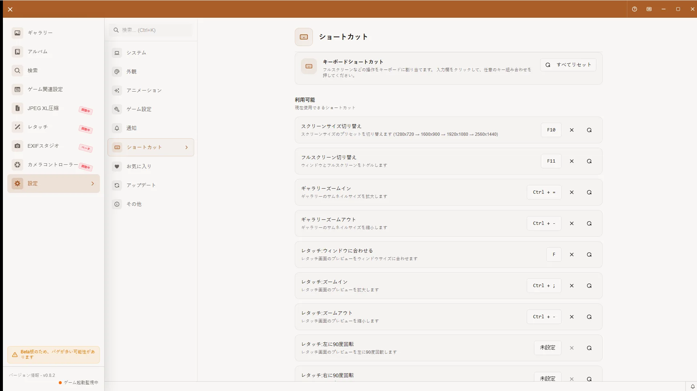

# キーボードショートカット一覧

## 開き方

設定画面から「ショートカット」を開きます。

[🏠 ドキュメントトップ](../index.md) | [⚖️ 利用規約](./terms.md) | [🔒 プライバシーポリシー](./privacy.md)

---

VSAアプリで使用できるキーボードショートカットの一覧です。このガイドでは、すべてのショートカットと、カスタマイズ方法について説明します。

## 実装済みショートカット

現在、以下の9つのショートカットが実装されています。

### 表示系

| 操作 | ショートカット | 説明 |
|------|----------------|------|
| スクリーンサイズ切り替え | `F10` | ウィンドウサイズをプリセット間で切り替え（1280×720 → 1600×900 → 1920×1080 → 2560×1440） |
| フルスクリーン切り替え | `F11` | ウィンドウモードとフルスクリーンをトグル |
| ギャラリーズームイン | `Ctrl` + `=` | ギャラリーのサムネイルサイズを拡大 |
| ギャラリーズームアウト | `Ctrl` + `-` | ギャラリーのサムネイルサイズを縮小 |
| レタッチ:ウィンドウに合わせる | `F` | レタッチ画面のプレビューをウィンドウに合わせる |
| レタッチ:ズームイン | `Ctrl` + `;` | レタッチ画面のプレビューを拡大 |
| レタッチ:ズームアウト | `Ctrl` + `-` | レタッチ画面のプレビューを縮小 |
| レタッチ:左に90度回転 | 現在の割り当てを設定画面で確認 | レタッチ画面のプレビューを左に90度回転 |
| レタッチ:右に90度回転 | 現在の割り当てを設定画面で確認 | レタッチ画面のプレビューを右に90度回転 |

### ショートカット詳細

#### スクリーンサイズ切り替え（F10）

ウィンドウサイズを段階的に変更します。

**サイズの順序**:
1. 1280 × 720（デフォルト）
2. 1600 × 900
3. 1920 × 1080（フルHD）
4. 2560 × 1440（2K）
5. 1280 × 720に戻る（サイクル）

**用途**:
- 複数モニター環境での画面サイズ最適化
- 異なる解像度での表示確認

#### フルスクリーン切り替え（F11）

ウィンドウモードとフルスクリーンを切り替えます。

**フルスクリーン時**:
- タイトルバーやタスクバーが非表示
- 画面全体でアプリケーションが表示
- 写真の表示領域が最大化

**ウィンドウモード時**:
- タイトルバーとウィンドウ枠が表示
- サイズ変更やドラッグが可能
- 他のアプリケーションを同時に表示可能

#### ギャラリーズームイン（Ctrl + =）

ギャラリーのサムネイルサイズを拡大します。

**動作**: 1回の入力でサムネイルまたは行のサイズを段階的に拡大します。

**用途**:
- 写真の詳細をより大きく表示
- 高解像度モニターでの使用

#### ギャラリーズームアウト（Ctrl + -）

ギャラリーのサムネイルサイズを縮小します。

**動作**: 1回の入力でサムネイルまたは行のサイズを段階的に縮小します。

**用途**:
- 多くの写真を一覧表示
- 大量の写真を素早く確認
- 日付グループ化の表示

#### レタッチ画面のショートカット

- `F`: プレビューをウィンドウに合わせる
- `Ctrl + ;` / `Ctrl + -`: プレビューを拡大・縮小
- 回転: 設定 > ショートカットで現在の割り当てを確認してください。開発中 v0.9.0では未設定の場合があります。

## カスタマイズ方法

### ショートカットキーの変更

デフォルトのショートカットを別のキー組み合わせに変更できます。

**ステップ**:

**ステップ1: 設定画面を開く**
1. サイドバーの歯車アイコン（⚙️）をクリック
2. 「設定」画面が表示される

**ステップ2: ショートカットパネルを選択**
1. 左側のメニューから「ショートカット」をクリック
2. すべての登録されているショートカットが表示される

**ステップ3: 変更対象のショートカットをクリック**
1. 変更したいショートカット行をクリック
2. 入力待機状態（枠が色付け）になります

**ステップ4: 新しいキー組み合わせを入力**
1. 修飾キー（Ctrl、Shift、Alt、Metaなど）を押したまま、メインキーを押す
2. 入力内容が画面に表示される
3. キーを離すと入力が確定

**ステップ5: 自動保存**
1. 入力が確定するとショートカットが自動的に更新される
2. 手動の保存ボタンはありません

### 入力例

**例1: Ctrl + Shift + = に変更**
1. 変更対象のショートカットをクリック
2. Ctrlキーを押したまま
3. Shiftキーを押したまま
4. =キーを押す
5. 「Ctrl + Shift + =」と表示される
6. 入力が確定すると自動的に保存されます

**例2: 単一のキーのみに変更**
1. 変更対象をクリック
2. 修飾キーなしでメインキーのみを押す
3. 例: 「F2」など（F5など予約済みキーは登録できません）
4. 入力が確定すると自動的に保存されます

### デフォルト設定のリセット

すべてのショートカットをデフォルト値に戻したい場合：

**ステップ**:
1. 設定 > 「ショートカット」パネルを開く
2. 「すべてリセット」をクリック
3. すべてのショートカットがデフォルトに戻ります

**注意**: この操作は取り消せません。重要な設定の場合は事前にメモしてください。

## 注意事項

### システムショートカットとの競合

Windowsのシステムショートカットと競合する場合があります。

**競合しやすいショートカット**:
- `Alt + Tab`: ウィンドウ切り替え
- `Ctrl + C`: コピー
- `Ctrl + V`: ペースト
- `Win` キー系: Windows特有の操作

**競合した場合**: ブラウザやOSの予約ショートカット、および同じ画面で重複する割り当ては登録できません。

**解決方法**:
- 別のキー組み合わせに変更する
- Windowsの設定で競合しないキーを使用

### アプリ全体での共有

ショートカットはVSAがアクティブな間に有効です。割り当てによって使える画面が異なります。

**特定の画面でのみ有効なショートカット**:
- ギャラリーズーム（ズームイン/アウト）: ギャラリー画面でのみ有効
- レタッチ系: レタッチ画面でのみ有効
- スクリーンサイズとフルスクリーン: VSAの各画面で有効

### キーボード配列による違い

使用しているキーボード配列により、表示が異なる場合があります。

**例**:
- 日本語キーボード: =キーの位置が異なる
- US配列キーボード: キー位置が異なる

**対応**:
- 実際に入力してみて、期待通りのキーが入力されるか確認
- 異なる場合は、別のキーに変更

## トラブルシューティング

### ショートカットが動作しない

**症状**: キーを押しても反応がない

**原因と対策**:

**修飾キーが正しく認識されていない**:
1. 設定 > ショートカットで、登録されているキー組み合わせを確認
2. 期待されるキーが設定されているか確認

**VSAウィンドウがアクティブでない**:
1. VSAウィンドウをクリック
2. ウィンドウがアクティブ（前面）になっているか確認
3. 他のアプリがアクティブでないことを確認

**Windowsシステムショートカットが優先**:
1. 別のキー組み合わせに変更
2. Windowsの設定でショートカットを確認

### ショートカット設定がリセットされる

**症状**: 設定したショートカットが、アプリ再起動後にリセットされている

**原因**:
- 設定ファイルが破損
- ディスク容量不足
- アクセス権限の問題

**解決方法**:
1. 設定を再度設定
2. アプリを再起動
3. それでも解決しない場合は、設定フォルダへの書き込み権限と空き容量を確認

### キーボード配列が認識されない

**症状**: キーボード配列が異なり、期待したキーが入力されない

**解決方法**:
1. Windowsのキーボード設定を確認
2. 使用しているキーボード配列に合わせて調整
3. 問題の場合は、別のキー組み合わせを試す

## ヒント

- **よく使うショートカット**: 頻繁に使用するスクリーンサイズ切り替えは、大きいモニター環境で便利
- **ズーム機能**: Ctrl += と Ctrl + - でギャラリーのサイズを素早く調整可能
- **レタッチ**: F、Ctrl + ;、Ctrl + - でプレビューを操作。回転キーは設定画面で確認
- **フルスクリーン**: F11でフルスクリーンにして、写真を大画面で確認
- **デュアルモニター**: F10でサイズを調整して、複数モニター間でウィンドウを移動

## 関連情報

- [設定画面完全ガイド](settings-guide.md) - ショートカット設定の詳細
- [ギャラリー操作ガイド](gallery-guide.md) - ギャラリーズーム機能の詳細
