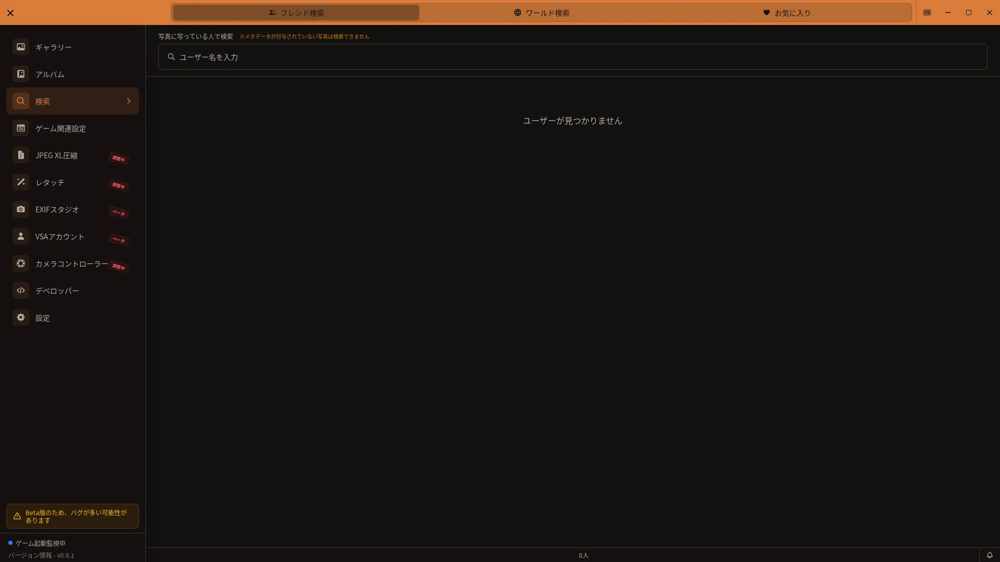

# ユーザー検索機能ガイド

## 開き方

VSAのサイドバーから「ユーザー検索」を開きます。

[🏠 ドキュメントトップ](../index.md) | [⚖️ 利用規約](./terms.md) | [🔒 プライバシーポリシー](./privacy.md)

---

ユーザー検索機能を使うことで、写真に写っているユーザーやワールド名で素早く検索し、特定のフレンドとの写真や特定のワールドで撮影した写真を探すことができます。このガイドでは、検索機能の使い方を説明します。

## 概要

ユーザー検索機能では以下のことができます：

- **タグベース検索**: ユーザー名を入力してタグのように追加
- **複数ユーザー検索**: 最大5人のユーザーを同時に検索（AND検索）
- **ローマ字検索対応**: 日本語をローマ字で検索可能
- **ワールド検索**: ワールド名で写真を検索
- **お気に入り**: ユーザーとワールドをお気に入り登録
- **ユーザーディレクトリ**: すべてのユーザーを一覧表示

## 前提条件

ユーザー検索機能を使用する際の重要な注意点：

### メタデータが必要

ユーザー情報を検索するには、**VRChatのメタデータが付与された写真**が必要です。

**メタデータが付与される条件**:
1. VRChatでスクリーンショットを撮影
2. VSAの「ゲーム関連設定」で監視元フォルダとログフォルダを設定
3. VRChatのログが作成されている

**メタデータが付与されない場合**:
- VRChatをプレイしていない時期の古い写真
- ゲーム関連設定の監視元・ログフォルダが正しく設定されていない
- VRChatのログが作成されていない

詳細は[ゲーム関連設定ガイド](game-config.md)を参照してください。

## 検索方法

### タグベース検索の使い方

ユーザー検索画面では、タグ入力バーでユーザー名を入力して検索します。

**ステップバイステップ**:

**ステップ1: ユーザー検索を開く**
1. サイドバーの「ユーザー検索」をクリック
2. ユーザー検索画面が表示される

**ステップ2: ユーザー名を入力**
1. 検索バーをクリック
2. ユーザー名を入力
3. ドロップダウン候補が表示される

**ステップ3: 候補から選択**
1. ドロップダウンから該当するユーザー名をクリック
2. または、↓キーで候補を選択してEnterキー
3. タグとして追加される

**ステップ4: 検索結果を確認**
1. そのユーザーが写っている写真一覧が下に表示される
2. グリッド形式で写真を閲覧
3. 写真をクリックで詳細表示

### ローマ字検索対応

日本語ユーザー名をローマ字で検索できます。

**例**:
- ユーザー名が「田中」の場合
- 「tanaka」や「たなか」で検索可能

**動作のコツ**:
- 英数字モードで入力してください（日本語入力モードはオフ）
- 部分一致で検索できます
- 例: 「tan」だけでも「田中」がヒット

### 複数ユーザーのAND検索

複数のユーザーを同時に検索し、**全員が写っている写真のみ**を表示します。

**手順**:
1. 最初のユーザーをタグに追加
2. 検索バーに次のユーザー名を入力
3. ドロップダウンから選択
4. 2番目のタグが追加される
5. 3番目、4番目...と最大5人まで追加可能

**検索結果**:
- すべて のユーザーが写っている写真のみが表示される
- 例: 「AさんとBさんとCさん」が全員写っている写真だけ

**タグの削除**:
- タグの×ボタンをクリック
- すぐに検索結果が更新される

**最大5人の制限**:
- パフォーマンス最適化のため、最大5人までの制限があります
- 6人目以降は追加できません

## ワールド検索

ユーザー検索画面上部の「ワールド検索」タブでは、ワールド名から写真を探せます。

**手順**:
1. 「ワールド検索」タブを開く
2. ワールド名の一部または全部を入力する
3. 絞り込まれたワールド名から目的のワールドをクリックする
4. 選択したワールドで撮影された写真を確認する

**補足**:
- ワールド名の横のハートをクリックするとお気に入りに登録できます
- 一度に選択できるワールドは1つです
- 選択中のワールド名と写真枚数が表示されます
- 選択を解除するには、選択中ワールドの×ボタンをクリックします
- 写真は通常50枚ずつ読み込まれ、結果の下までスクロールすると追加表示されます

## ユーザーディレクトリ

ユーザー未選択時に表示される、全ユーザーの一覧です。

### すべてのユーザー一覧

**表示される情報**:
- **五十音順**: あ行→か行→...の順に表示
- **ユーザー名**: 日本語名とローマ字の両方で認識
- **写真数**: 各ユーザーが写っている写真の総数
- **お気に入りアイコン**: 星マークでお気に入り登録の有無を表示

### スクロールと検索

**手順**:
1. ディレクトリをスクロール
2. 目的のユーザー名を探す
3. ユーザー名をクリック
4. そのユーザーが写っている写真が表示される

**検索バーを使う方法**:
1. 検索バーに文字を入力
2. 一致するユーザーだけをディレクトリにフィルタリング
3. 候補から選択

### お気に入りユーザー管理

よく検索するユーザーをお気に入りに登録できます。

**登録方法**:
1. ユーザーディレクトリ内で、ユーザー名の横にある★アイコンをクリック
2. 星が塗りつぶされてお気に入り登録完了

**削除方法**:
1. お気に入りタブで「フレンド」を選び、★アイコンをクリック
2. またはディレクトリで再度★をクリック

## お気に入りタブ

### タブの切り替え

ユーザー検索画面上部には「フレンド検索」「ワールド検索」「お気に入り」タブがあります。お気に入りタブの「お気に入りの種類」で、フレンドとワールドを切り替えられます。

### お気に入りユーザー

- 「お気に入りの種類」で「フレンド」を選択
- お気に入り登録したユーザーだけが表示されます
- ユーザー名をクリックすると、そのユーザーの写真を検索できます
- ★アイコンをクリックするとお気に入りを解除できます

### お気に入りワールド

- 「お気に入りの種類」で「ワールド」を選択
- お気に入り登録したワールドが表示されます
- ワールド名をクリックすると、そのワールドの写真を検索できます
- ハートアイコンをクリックするとお気に入りを解除できます

## 検索結果の表示

### グリッド表示

検索結果の写真はグリッド形式で表示されます。

**特徴**:
- レスポンシブレイアウト（ウィンドウサイズに応じた列数）
- サムネイルをクリックで詳細表示
- ホバーで追加情報を表示

**表示される写真数**:
- ページごとに約50枚を表示
- 下にスクロールすると次のページを自動読み込み

### 無限スクロール

ページング不要で、スクロールするだけで次の写真が自動的に読み込まれます。

**動作**:
1. 画面下部が見える位置までスクロール
2. 自動的に次の50枚を読み込み
3. 読み込み中は「読み込み中...」表示
4. すべての写真を読み込むまでこれを繰り返す

**パフォーマンス**:
- 50枚単位での読み込みでパフォーマンスを最適化
- 大量の写真があってもスムーズにスクロール可能

### 写真詳細サイドバーとの連携

検索結果の写真をクリックすると、詳細サイドバーが右側に表示されます。

**表示される情報**:
- プレビュー画像
- ワールド名
- 撮影日時
- インスタンス内のユーザー一覧
- カメラパラメータ

**サイドバーからのユーザー検索**:
1. 詳細サイドバーのユーザー一覧から、ユーザー名をクリック
2. 検索バーにそのユーザータグが追加される
3. 自動的に検索結果が更新される（AND検索）

**次/前の写真**:
1. サイドバー上部の矢印ボタン（◀/▶）をクリック
2. 検索結果内の前後の写真に移動
3. 検索結果の最後/最初に達するとボタンは無効化

## 使用例

### 例1: 特定のフレンドとの写真を探す

**シナリオ**: 「Aさん」との写真をすべて見たい

**手順**:
1. ユーザー検索を開く
2. 検索バーに「Aさん」（またはローマ字）を入力
3. ドロップダウンから「Aさん」を選択
4. Aさんが写っている写真一覧が表示される
5. 写真をクリックして詳細を確認

### 例2: イベント参加者の写真を探す

**シナリオ**: 「AさんとBさんとCさん」が全員写っている写真を探す

**手順**:
1. ユーザー検索を開く
2. 検索バーに「Aさん」を入力 → 選択
3. 検索バーに「Bさん」を入力 → 選択
4. 検索バーに「Cさん」を入力 → 選択
5. 3人全員が写っている写真のみが表示される

### 例3: ローマ字で検索する

**シナリオ**: 日本語名が分からず、ローマ字で検索

**手順**:
1. 日本語入力モードをオフに（英数字モード）
2. 検索バーにローマ字を入力（例:「yamada」）
3. マッチするユーザー（例: 「山田」）がドロップダウンに表示
4. ドロップダウンから選択
5. 検索開始

### 例4: お気に入りユーザーから素早く検索

**シナリオ**: よく撮影するフレンドの写真を素早く探す

**手順**:
1. ユーザー検索を開く
2. 上部の「お気に入り」タブをクリック
3. 登録済みのお気に入りユーザーが表示される
4. ユーザー名をクリック
5. その人が写っている写真が表示される

## トラブルシューティング

### ユーザーが検索できない（メタデータ未付与）

**症状**: 「該当するユーザーはいません」と表示される、またはユーザー一覧が空

**原因**:
- VRChatのメタデータが付与されていない
- ゲーム関連設定の監視元・ログフォルダが正しく設定されていない
- 古い写真でメタデータが記録されていない

**解決方法**:

**ステップ1: ゲーム関連設定を確認**
1. ゲーム関連設定 > 画面設定を開く
2. 「監視元フォルダ」と「ログフォルダ」が設定されているか確認
3. パスが正しいか確認

詳細は[ゲーム関連設定ガイド](game-config.md)を参照してください。

**ステップ2: 新しい写真を撮影**
1. ゲーム関連設定を完了後、VRChatで新しいスクリーンショットを撮影
2. 数秒待機してVSAに反映されるのを待つ
3. ユーザー検索で新規ユーザーが表示されるか確認

**ステップ3: 写真のメタデータとログを確認**
1. ギャラリーで新しい写真の詳細サイドバーを開く
2. ユーザー情報が記録されているか確認
3. 改善しない場合は、ログと症状を添えて問い合わせる

### 検索結果が0件の場合

**症状**: ユーザーは存在するが、「○○さんが写っている写真はありません」と表示される

**考えられる原因**:
- メタデータが正しく読み込まれていない
- ユーザーが実際には写っていない（メタデータのみ存在）

**解決方法**:

**ステップ1: メタデータを確認**
1. ギャラリーで同じユーザーが記載された別の写真を探す
2. その写真の詳細サイドバーでユーザー一覧を確認
3. ユーザー名のスペルが一致しているか確認（大文字/小文字）

**ステップ2: 再取り込みを確認**
1. ゲーム関連設定の監視元フォルダとログフォルダを確認
2. 新しい写真を撮影し、取り込みが完了するまで待つ
3. 改善しない場合は、ログと症状を添えて問い合わせる

### ローマ字検索が動作しない

**症状**: ローマ字を入力しても候補が表示されない

**原因**:
- 日本語入力モードがオン（漢字変換待ちの状態）
- ユーザー名に対応するローマ字がない

**解決方法**:

**ステップ1: 入力モードを確認**
1. Windowsの言語バーで「英数字」モードになっているか確認
2. 日本語入力モード（ひらがな/カタカナ）をオフに

**ステップ2: 日本語で検索**
1. 日本語入力モードをオン
2. ひらがなで入力してみる（例: 「やまだ」）
3. 候補が表示されるか確認

**ステップ3: フルスペル入力**
- 短い入力で目的の候補が見つからない場合は、名前の表記を長く入力してみる
- 例: 「ya」ではなく「yamada」

## ヒント

- **五十音順**: ディレクトリは五十音順で整理されているため、似た名前を探しやすい
- **複数デバイス**: 複数のPCでVSAを使用している場合、各PC上でメタデータが別々に蓄積される
- **パフォーマンス**: 大量のユーザーがいる場合、ローマ字検索で絞り込むとより速く検索できる

## 関連情報

- [ゲーム関連設定ガイド](game-config.md) - メタデータ設定の詳細
- [ギャラリー操作ガイド](gallery-guide.md) - ギャラリー機能の詳細
- [VRChat連携ガイド](vrchat-integration.md) - メタデータの仕組み
