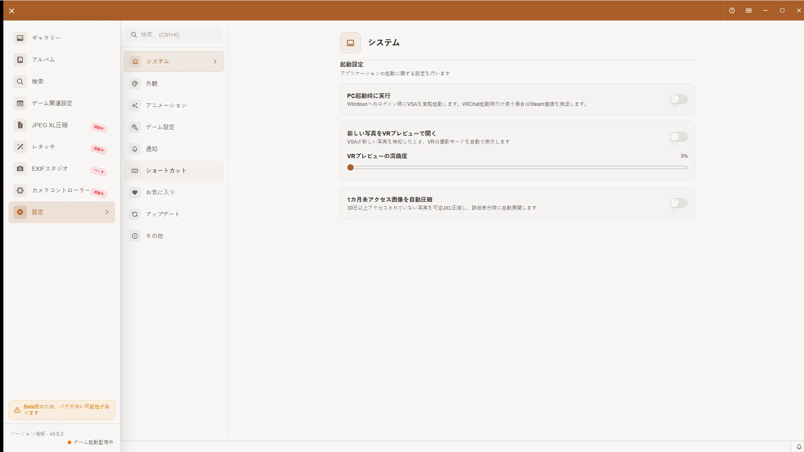

# 設定画面完全ガイド

## 開き方

VSAのサイドバーから「設定」を開きます。

[🏠 ドキュメントトップ](../index.md) | [⚖️ 利用規約](./terms.md) | [🔒 プライバシーポリシー](./privacy.md)

---

設定画面では、VSAアプリケーション全体の動作を細かくカスタマイズできます。このガイドでは、すべての設定オプションについて詳しく説明します。

「アプリケーション情報」と「チュートリアル」パネルの説明は開発中 v0.9.0向けです。配布中の v0.8.2では表示されないことがあります。

## 設定画面へのアクセス

サイドバー下部の**歯車アイコン（⚙️）**をクリックして、設定画面を開きます。

設定画面は左側に設定パネルのメニュー、右側に詳細設定が表示されるレイアウトになっています。

## 設定画面の構成

設定画面には通常11個のパネルがあります。クラウドUIが利用できる環境では、「ショートカット」の後に「X投稿」が追加され、12個になります。

1. **システム（System）** - 起動や自動処理に関する設定
2. **アプリケーション情報（Application Info）** - バージョンと連携状態
3. **外観（Appearance）** - テーマとカラー、言語設定
4. **アニメーション（Animation）** - 画面エフェクトの設定
5. **ゲーム設定（Game Settings）** - 監視元・出力先・ログフォルダ、OSC
6. **通知（Notification）** - 通知設定
7. **ショートカット（Shortcut）** - キーボードショートカット
8. **お気に入り（Favorites）** - お気に入り管理
9. **チュートリアル（Tutorial）** - アプリ内チュートリアルの起動
10. **アップデート（Update）** - 更新確認とリリースノート
11. **その他（Other）** - 規約、プライバシー、ライセンス、外部リンク、重要なお知らせ

クラウドUIが利用できる環境では、「ショートカット」の後に**X投稿（X Post）**が表示され、その後のパネルは1つずつ後ろへ移動します。

## システム（System）

- **PC起動時に実行**: Windowsへのログイン時にVSAを起動します。
- **新しい写真をVRプレビューで開く**: VSAが新しい写真を検知したとき、VRの撮影モードを自動表示します。
- **VRプレビューの湾曲度**: VR内で表示する写真面の湾曲を調整します。
- **古い写真の自動アーカイブ**: 1、2、3、4、6、12カ月から対象期間を選び、古い写真を可逆JXLで保管します。保存先は現在の写真出力先配下の `VSA-Archive` に追従します。

撮影直後の写真を全画面で確認する**撮影者モード**は、タイトルバーのVRアイコンから起動します。新しい写真のVRプレビュー自動表示と湾曲度は、このシステムパネルで設定します。詳しい操作は[撮影者モードガイド](photographer-mode.md)を参照してください。

## アプリケーション情報（Application Info）

インストール済みのバージョン、VRChatとの連携状態、写真監視の状態を確認できます。「診断情報を更新」で状態を再取得します。

## 外観（Appearance）

外観パネルでは、アプリの見た目と言語を設定します。

### テーマ設定

アプリの配色スキームを選択します。

#### ライト/ダーク/システム連動

3つのテーマモードがあります：

**ライト**:
- 白基調の配色
- 昼間や明るい環境での使用に適しています

**ダーク**:
- 黒基調の配色
- 目への負担を軽減
- 夜間や暗い環境での使用に適しています

**システム連動**:
- Windowsの設定に自動的に追従
- Windowsのテーマをライトに設定するとVSAもライトに変更
- Windowsのテーマをダークに設定するとVSAもダークに変更

**推奨**: Windowsの設定に統一するため、「システム連動」の選択をお勧めします。

### テーマカラーセレクター

アプリのアクセントカラーを選択します。

#### 3種類のプリセット

以下の3種類のプリセットが用意されています：

- **暗室**: 黒鉛色とアンバー
- **夜景**: 青黒とコバルト
- **印画紙**: 温かい白と青緑のインク

**使い方**:
1. 好みの色を選択
2. アプリの各所（ボタン、アイコン、ハイライト等）の色が変更されます
3. 設定は自動的に保存されます

#### カラーアニメーション効果

テーマカラーの変更時に、カラーアニメーション効果を有効/無効にします。

**有効**:
- カラー変更時にスムーズなトランジション効果が表示
- より洗練された見た目

**無効**:
- カラーがすぐに変更される
- アニメーション効果による処理を軽減

### 言語設定

アプリの表示言語を選択します。

#### 日本語/英語

2つの言語から選択できます：

**日本語**:
- UIの多くが日本語で表示されます。
- 日本語のガイドを利用できます。

**英語**:
- UIの多くが英語で表示されます。
- アプリ内チュートリアルは現在日本語で表示されます。

**変更方法**:
1. ドロップダウンメニューから言語を選択
2. 設定が即座に反映されます
3. 再起動は不要です

### 開発者モード

開発者向けの高度な機能を有効/無効にします。

**有効にすると**:
- サイドバーに「開発者」メニューが表示
- 開発者向けの診断・テスト設定やセットアップウィザードのリセットが利用可能

**推奨**: 一般ユーザーは無効のままでも問題ありません。トラブル解決時のみ有効にしてください。

## アニメーション（Animation）

アニメーション（Animation）パネルでは、画面遷移やエフェクトを設定します。

### アニメーション効果のオン/オフ

全体的なアニメーション効果を有効/無効にします。

**有効**:
- フェードエフェクト（要素の表示/非表示時）
- トランジション効果（画面遷移時）
- レイアウトアニメーション（リスト項目の追加/削除時）
- より視覚的にわかりやすい動作

**無効**:
- アニメーション効果が表示されません
- 画面がすぐに切り替わります
- CPU処理が軽くなるため、パフォーマンスが向上します

**選択のコツ**:
- 新しいPC: アニメーション効果を有効にして、洗練された見た目を楽しむ
- 古いPCまたはスペック不足: アニメーションを無効にしてパフォーマンスを優先
- 酔いやすい方: アニメーションを無効にすることで快適になる場合があります

## 通知（Notification）

VSAの通知方法、通知するイベント、通知音を設定します。

### 通知方法

OS通知とトースト通知を個別に切り替えます。

- **OS通知**: Windows通知センターに表示
- **トースト通知**: アプリ内の右下に表示
- 両方をOFFにすると通知は表示されません。

OS通知を使う場合は、Windowsの設定でVSAからの通知を許可してください。

### 通知の種類

通知方法のいずれかがONのとき、次のイベントを個別に切り替えられます。

- **インポート完了**: 画像の取り込みが完了したとき
- **写真取り込み中**: ゲームが写真を撮影したとき
- **圧縮完了**: JXL圧縮が完了したとき
- **エラー通知**: エラーが発生したとき
- **VRChat起動通知**: VRChatが起動したとき
- **VRChat終了通知**: VRChatが終了したとき

### サウンド

「通知音を再生」をONにすると、通知時に音が鳴ります。音量スライダーや通知履歴の設定項目はありません。

通知履歴は画面下部のベルアイコンから確認できます。履歴を開くと未読件数が既読になります。履歴の個別削除・一括消去ボタンはありません。

## ショートカット（Shortcut）

キーボードショートカットを管理します。

### キーボードショートカット一覧

現在実装されているショートカットは以下の9つです：

#### 表示系

| 操作 | デフォルトキー | 説明 |
|------|----------------|------|
| スクリーンサイズ切り替え | `F10` | 1280×720 → 1600×900 → 1920×1080 → 2560×1440 |
| フルスクリーン切り替え | `F11` | ウィンドウとフルスクリーンを切り替え |
| ギャラリーズームイン | `Ctrl + =` | サムネイルサイズを拡大 |
| ギャラリーズームアウト | `Ctrl + -` | サムネイルサイズを縮小 |
| レタッチ:ウィンドウに合わせる | `F` | レタッチ画面のプレビューをウィンドウサイズに合わせる |
| レタッチ:ズームイン | `Ctrl + ;` | レタッチ画面のプレビューを拡大 |
| レタッチ:ズームアウト | `Ctrl + -` | レタッチ画面のプレビューを縮小 |
| レタッチ:左に90度回転 | 設定画面で現在の割り当てを確認 | レタッチ画面のプレビューを左に90度回転 |
| レタッチ:右に90度回転 | 設定画面で現在の割り当てを確認 | レタッチ画面のプレビューを右に90度回転 |

開発中 v0.9.0では、回転キーが未設定の場合があります。実際に使うキーは「ショートカット」パネルで確認してください。

### カスタマイズ方法

ショートカットキーを変更したい場合：

**手順**:
1. 変更したいショートカット行をクリック
2. キー入力待機状態になります
3. 新しいキーの組み合わせを入力（修飾キー+キー）
4. 入力が確定すると自動的に保存されます。保存ボタンはありません。

**例**: 「ギャラリーズームイン」を`Ctrl + Shift + =`に変更したい場合
1. ギャラリーズームインをクリック
2. `Ctrl`キーを押しながら`Shift`キーを押しながら`=`キーを押す
3. 入力が確定すると自動的に保存されます。

### デフォルト設定のリセット

すべてのショートカットをデフォルトに戻したい場合：

**手順**:
1. 「すべてリセット」ボタンをクリック
2. すべてのショートカットがデフォルトに戻ります

### 注意事項

**システムショートカットとの競合**:
- Windowsのシステムショートカット（例：`Alt + Tab`）と競合する場合があります
- ブラウザやOSの予約ショートカット、同じ画面での重複割り当ては登録できません

**適用範囲**:
- スクリーンサイズとフルスクリーンは、VSAの各画面で有効です。
- ギャラリーズーム系はギャラリー画面、レタッチ系はレタッチ画面でのみ有効です。

**詳細は**[キーボードショートカット一覧](keyboard-shortcuts.md)を参照してください。

## ゲーム設定（Game Settings）

設定画面のゲーム設定パネルでは、ゲーム関連設定の**画面設定**（監視元・出力先・ログフォルダ、OSC）を編集します。スイッチや入力欄は自動保存され、手動の保存ボタンはありません。

Steam、Virtual Desktop、VRChat障害通知は、サイドバーの[ゲーム関連設定](game-config.md) > **プラグイン**で設定します。イベント履歴は同画面の**タイムマシーン**タブで確認できます。

## お気に入り（Favorites）

お気に入り機能に関する設定を行います。

### お気に入りフォルダ移行

お気に入りの保存先フォルダを選択し、既存のお気に入り画像をそのフォルダへ移行できます。

**移行方法**:
1. 「保存先フォルダ」からフォルダを選択
2. 「お気に入り画像を移行」をクリック
3. 成功・失敗件数と、失敗した画像の詳細を確認

お気に入りを登録すると、設定したフォルダに元画像のコピーが作成されます。写真詳細の星ボタンで個別に解除すると、VSAが記録しているコピーも削除されます。お気に入りの選択モードで一括解除した場合は登録状態だけを解除し、元画像とコピーは残ります。

詳細は[お気に入り機能ガイド](favorites-guide.md)を参照してください。

## チュートリアル（Tutorial）

チュートリアルを選ぶと、アプリ内で操作案内を開始できます。完了済みのチュートリアルにはチェックマークが表示されます。チュートリアルは現在日本語で表示されます。

## アップデート（Update）

アプリケーションのバージョン確認とリリースノートを開きます。

### アップデート確認

「アップデートを確認」をクリックすると、新しいバージョンがあるか確認できます。利用可能な場合は、内容を確認してダウンロードと再起動を実行できます。

### バージョン情報とリリースノート

現在インストールされているVSAのバージョン番号が表示されます。

「リリースノート」から現在のバージョンのリリースノートを開けます。GitHub Releasesやドキュメントなどの外部リンクは**その他**パネルにあります。

## その他（Other）

その他パネルでは、ユーザーに周知しておくべき情報を確認できます。

### 規約・プライバシー・ライセンス

以下の公開ドキュメントを開けます。

- 利用規約
- プライバシーポリシー
- ライセンス情報
- Google OAuth公開設定用のプライバシーポリシーURL

### 外部リンク

以下のページを開けます。

- ドキュメントトップ
- GitHub Releases

### 重要なお知らせ

以下の内容をアプリ内で確認できます。

- 正式名称は **Virtual Snap Archive** であり、VRChat Inc.、VirtualLens2、Integralおよび各権利者とは提携・承認・サポート関係にない非公式ツールであること
- ローカル基本機能は無料で利用できる一方、クラウド保存とX APIは無料枠超過時に料金が発生する場合があること
- VSAアカウント、クラウド保存、X投稿、Turnstile、アップデート確認、サーバーステータス表示では外部通信が発生すること
- ローカルファイルへのアクセスは、ユーザーが選択した監視フォルダ・書き出し先とVSAの管理領域を中心に行われること
- Windows版インストーラーは未署名の場合があり、SmartScreen等の警告が出る場合があること

## 設定を初期値に戻す

現在はアプリ全体を一括リセットするボタンはありません。対応する画面のリセット操作を使ってください。

- ゲーム関連設定: 出力フォルダとログフォルダを個別に既定値へ戻せます
- ショートカット: 「すべてリセット」で9種類を初期値へ戻せます（確認ダイアログはありません）
- その他の設定: 各パネルの項目を手動で戻します

アプリの管理データを手動で削除・置換せず、改善しない場合はログと症状を添えて問い合わせてください。

## 設定の保存

設定は各パネルの変更時に自動保存されます。設定ファイルを手動で編集・置換する手順はサポート対象外です。問題が続く場合は、各パネルの設定を確認し、ログと症状を添えて問い合わせてください。

## 使用例

### 例1: 暗い環境で作業する場合

1. テーマ: 「ダーク」を選択
2. テーマカラー: 「夜景」を選択
3. アニメーション: パフォーマンスが低い場合は無効化
4. 設定が自動的に保存されます

### 例2: 古いPCで快適に使用する場合

1. アニメーション: 無効化
2. VRプレビューの自動表示: 必要に応じて無効化
3. 古い写真の自動アーカイブ: 必要に応じて有効化
4. 設定が自動的に保存されます

### 例3: ショートカットをカスタマイズする場合

1. 「ショートカット」パネルを開く
2. 変更したいショートカットをクリック
3. 新しいキーの組み合わせを入力
4. 入力した組み合わせが自動的に保存されます（保存ボタンはありません）

## トラブルシューティング

### 設定が反映されない

**症状**: 設定を変更しても、アプリに反映されない

**解決方法**:
1. 変更後、アプリを再起動してください
2. それでも反映されない場合、該当パネルの設定を初期値に戻してください

### 設定が保存されない

**症状**: アプリを再起動すると、設定がリセットされている

**解決方法**:
1. `%APPDATA%/VSA/`ディレクトリへの書き込み権限があるか確認
2. ディスクの空き容量を確認
3. アプリを管理者権限で実行

## 関連情報

- [キーボードショートカット一覧](keyboard-shortcuts.md) - ショートカットの詳細
- [お気に入り機能ガイド](favorites-guide.md) - お気に入りの登録、書き出し、解除
- [ゲーム関連設定ガイド](game-config.md) - フォルダ、OSC、プラグイン、タイムマシーンの詳細
- [利用規約](terms.md) - 利用条件
- [プライバシーポリシー](privacy.md) - データの取り扱い
- [ライセンス情報](../license.md) - ライセンスと第三者ソフトウェア
- [トラブルシューティング詳細ガイド](troubleshooting.md) - より詳しい問題解決方法
