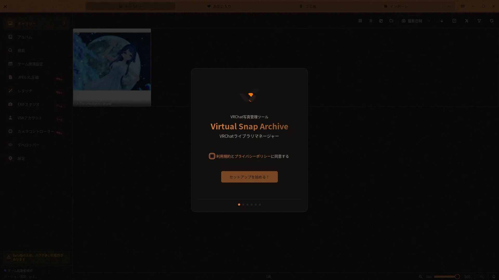

# 初回セットアップガイド

## 開き方

初回起動時にセットアップウィザードが表示されます。



[🏠 ドキュメントトップ](../index.md) | [⚖️ 利用規約](./terms.md) | [🔒 プライバシーポリシー](./privacy.md)

---


VSAアプリを初めて起動すると、セットアップウィザードが表示されます。このガイドでは、セットアップウィザードの各ステップについて詳しく説明します。

## セットアップウィザードの概要

セットアップウィザードは、VSAを初めて使用するときの基本的な設定をサポートします。

**所要時間**: 2～5分

**ウィザードが表示される場合**:
- VSAを初めて起動したとき
- 設定 > システムで開発者モードを有効にし、開発者メニューからセットアップをリセットした後

## セットアップのステップ

### ステップ1: ようこそ画面

VSAアプリケーションの紹介ページです。

**表示内容**:
- VSAのロゴとプロダクト名
- 簡単な説明文
- VSAの主な特徴

**説明内容**:
- VRChatの写真管理
- JPEG XL圧縮機能
- メタデータの自動抽出

**操作**:
- 「次へ」ボタン: 次のステップに進む

### ステップ2: 言語とテーマ選択

アプリの表示言語とビジュアルテーマを選択します。

#### 言語設定

**選択肢**:
- **日本語**: UIの多くが日本語で表示されます。
- **英語**: UIの多くが英語で表示されます。アプリ内チュートリアルは現在日本語で表示されます。

**選択方法**:
1. ラジオボタンまたはドロップダウンから言語を選択
2. 選択が即座に反映される場合があります

**後から変更**:
- 設定 > 外観 > 言語設定から変更可能

#### テーマ設定

**テーマモード**:
- **ライト**: 白基調の配色（明るい環境に推奨）
- **ダーク**: 黒基調の配色（目への負担を軽減）
- **システム連動**: Windowsの設定に自動追従（推奨）

**選択方法**:
1. テーマモードを選択
2. プレビューで見た目が即座に変更される

**後から変更**:
- 設定 > 外観 > テーマ設定から変更可能

#### テーマカラーセレクター

アプリのアクセントカラーを選択します。

**3種類のプリセット**:
- **暗室**: 黒鉛色とアンバー
- **夜景**: 青黒とコバルト
- **印画紙**: 温かい白と青緑のインク

**選択方法**:
1. 好みの色をクリック
2. アプリの各所の色が変更される

**後から変更**:
- 設定 > 外観 > テーマカラーセレクターから変更可能

### ステップ3: フォルダ設定

VRChatのスクリーンショットフォルダを指定します。

- 月別の子フォルダへ写真を整理するか選べます。
- 既存写真を今回取り込むか、今後の新しい写真だけを対象にするか選べます。
- 「出力先フォルダを変更する」をオンにすると、処理済み写真の保存先を別に指定できます。オフの場合はVRChatフォルダを使います。

#### スクリーンショットフォルダ設定

VRChatが写真を保存するフォルダを指定します。

**デフォルトパス**:
```
C:\Users\[ユーザー名]\Pictures\VRChat
```

**設定方法**:
1. 「フォルダを選択」ボタンをクリック
2. フォルダ選択ダイアログが開く
3. VRChatの写真フォルダを選択
4. 「フォルダを選択」をクリック

**確認方法**:
- パスが表示される
- 正しいパスか確認

**VRChat標準フォルダ位置**:
```
Windows: C:\Users\[ユーザー名]\Pictures\VRChat
```

#### フォルダが見つからない場合

**ステップ**:
1. Windowsエクスプローラーを開く
2. `C:\Users\[ユーザー名]\Pictures\`を手動で開く
3. `VRChat`フォルダの有無を確認

**VRChatをまだ起動していない場合**:
- VRChatを起動してスクリーンショットを1枚撮影
- `Pictures\VRChat`フォルダが自動作成されます

**カスタムフォルダを使用している場合**:
1. ウィザードで「フォルダを選択」をクリック
2. VRChatで設定しているカスタムフォルダを選択
3. 「フォルダを選択」をクリック

### ステップ4: 追加フォルダ

VRChatの出力先以外にも写真がある場合は、追加の取り込みフォルダを登録できます。フォルダを追加すると、その場で既存画像の取り込みが始まります。不要な場合は追加せず次へ進めます。

### ステップ5: 起動方法

Windowsログイン時にVSAを自動で開始するかを選びます。後から設定 > システムで変更できます。

**選択肢**:
- **Windowsログイン時にVSAを開始**: Windowsへのログイン後、VSAをバックグラウンドで常駐させます。

**選択方法**:
1. スイッチをオンにします。

**後から変更**:
- Windows自動起動: 設定 > システム
- Steam連携: [ゲーム関連設定](game-config.md) > プラグイン

### ステップ6: JXLアーカイブと完了

古い写真を可逆JXLで保管する場合は、自動アーカイブを有効にして対象月数（1、2、3、4、6、12カ月）を選びます。アーカイブ先は読み取り専用で表示され、現在の写真出力先配下の `VSA-Archive` に追従します。使用しない場合は無効のまま完了できます。

セットアップが完了し、メイン画面に移動します。

**完了画面**:
- 設定内容の確認
- 「完了」ボタン

**完了後**:
1. 「完了」をクリック
2. メイン画面が表示される
3. ギャラリービューが表示される
4. 選択内容に応じて写真の移行と取り込みが実行され、件数・割合・現在のファイルが表示されます
5. 失敗した場合は、完了済みの処理を保持したままセットアップを閉じるか、フォルダ設定へ戻れます

## セットアップの再実行方法

セットアップをやり直したい場合：

### 方法1: 開発者メニューからリセット

**ステップ**:
1. 設定 > システムで開発者モードを有効化
2. サイドバーの「開発者」を開く
3. リセット欄の「セットアップウィザード」をリセット
4. VSAを再起動

設定ファイルを手動で削除・置換する方法は使用しないでください。

## トラブルシューティング

### セットアップが完了しない

**症状**: ウィザードが進まない、または応答なくなる

**原因と対策**:

**アプリが応答していない**:
1. Ctrl + Alt + Delete
2. タスクマネージャーを開く
3. VSAプロセスを選択
4. 「タスクの終了」をクリック
5. VSAを再起動

**ディスク容量が不足**:
1. ディスク容量を確認
2. 不要なファイルを削除
3. 数GB以上の空き容量を確保
4. VSAを再起動

**ウィザード中に「次へ」が反応しない**:
1. マウスをクリックし直す
2. キーボードのEnterキーを押す
3. 別のボタンをクリック
4. 反応があるか確認

### フォルダ選択ができない

**症状**: フォルダを選択しようとするとダイアログが表示されない

**原因と対策**:

**ダイアログが別のウィンドウに隠れている**:
1. VSAやほかのウィンドウの背後にフォルダ選択画面がないか確認
2. 見つからない場合はVSAを再起動して選び直す

**フォルダのアクセス権限**:
1. 対象フォルダを右クリック
2. プロパティを開く
3. セキュリティタブでアクセス権限を確認
4. 読み取り権限があるか確認

### VRChatフォルダが見つからない

**症状**: VRChatをインストールしているのに、フォルダが見当たらない

**確認事項**:

**VRChatの実際のインストール状態**:
1. VRChatが実際にインストールされているか確認
2. VRChatを起動してスクリーンショットを1枚撮影
3. スクリーンショット撮影後、`Pictures\VRChat`フォルダを確認

**フォルダの表示設定**:
1. Windowsエクスプローラーを開く
2. 表示タブから「隠しファイルを表示」をオン
3. 隠しフォルダが表示されるか確認

**カスタムフォルダを使用している場合**:
1. VRChatの設定でカスタム出力フォルダを確認
2. ウィザードでそのフォルダを指定

## ベストプラクティス

### セットアップ時のコツ

**言語設定**:
- インターフェースが理解しやすい言語を選択
- 必要に応じて、同じ言語のガイドを参照します

**テーマ選択**:
- 推奨: 「システム連動」でWindowsの設定に合わせる
- 環境や時間に応じて自動的に切り替わります

**フォルダ設定**:
- デフォルトフォルダでない場合は、VRChatの設定を確認
- 複数フォルダを使用している場合は、メインフォルダを指定

**自動起動設定**:
- Windowsログイン後もVSAを常駐させる場合は有効化
- 一時的に常駐させない場合は無効化

## セットアップ後にすべきこと

セットアップが完了したら、以下のステップを進めることをお勧めします：

1. **ギャラリーを確認**: インポートされた写真を確認
2. **メタデータを確認**: 写真詳細でワールド名やユーザー名が表示されているか確認
3. **ゲーム関連設定を確認**: [ゲーム関連設定ガイド](game-config.md)で監視元、ログ、OSC、必要なプラグインを確認

## 関連情報

- [基本的な使い方](../basic-usage.md) - VSAの全体的な使い方
- [ゲーム関連設定ガイド](game-config.md) - VRChat連携の詳細設定
- [設定画面完全ガイド](settings-guide.md) - 詳細な設定オプション
- [トラブルシューティング詳細ガイド](troubleshooting.md) - 問題が発生した場合
