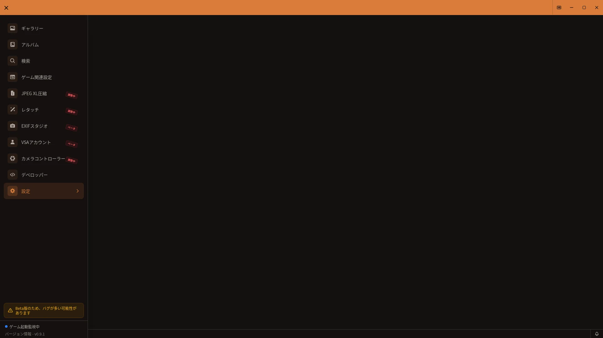

# VRChat連携

## 開き方

サイドバーからゲーム関連設定を開きます。フォルダとOSCは画面設定タブで確認します。



[🏠 ドキュメントトップ](../index.md) | [⚖️ 利用規約](./terms.md) | [🔒 プライバシーポリシー](./privacy.md)

---


VSAはVRChatで撮影した写真から自動的にメタデータを抽出し、保存します。このガイドでは、VSAが保存するメタデータとその仕組みについて説明します。

> **注意（Integralのパラメータ）**
> Integralには対応していますが、カメラパラメータの一部は正しく記録・表示されない場合があります。

## メタデータの概要

VRChatで写真を撮影すると、VSAは以下の情報を自動的にPNG画像に埋め込みます。

- ワールド情報
- ユーザー情報
- カメラパラメータ
- 撮影日時

これらの情報はPNGメタデータとして保存され、VSAを使わなくても対応する他のツールで読み取ることができます。

## ワールド情報

撮影時に滞在していたワールドの情報が記録されます。

| 項目 | 説明 | 例 |
|------|------|-----|
| ワールド名 | VRChatのワールド名 | "Japan Shrine" |
| ワールドID | VRChatの内部ID | "wrld_xxx..." |
| インスタンスID | インスタンスの識別子 | "12345~hidden(usr_xxx)" |
| インスタンスタイプ | アクセス権限 | Public, Friends+, Friends, Invite+, InviteOnly |

## ユーザー情報

撮影時のユーザー情報が記録されます。

| 項目 | 説明 |
|------|------|
| 撮影者名 | 写真を撮影したユーザー名 |
| 撮影者ID | VRChatのユーザーID（usr_xxx形式） |
| 参加者リスト | インスタンス内の全ユーザー名 |

参加者リストには、撮影時点でインスタンスにいた全員のユーザー名が含まれます。

## カメラパラメータ

撮影時に取得できたカメラ種別とOSCパラメータが記録されます。取得できる項目はカメラとアバター、撮影時のOSC状態によって異なります。

### VirtualLens2

VirtualLens2使用時に記録されるパラメータ:

| パラメータ | 説明 |
|-----------|------|
| Aperture | 絞り値。アバターが提供する最小値・最大値も表示される場合があります |
| Focal Length | 焦点距離 |
| Exposure | 露出補正 |

### Integral

Integral使用時に記録されるパラメータ:

| パラメータ | 説明 |
|-----------|------|
| Aperture | 絞り値（F値） |
| Focal Length | 焦点距離 |
| Exposure | 露出補正 |
| Shutter Speed | シャッタースピード |
| Bokeh Shape | ボケの形状 |

フォーカス、収差、合成モードなど追加の値が保存されている場合は、写真詳細のIntegral欄に追加表示されます。

### FishEye / TelePortraitLens

両方ともカメラコントローラーから操作できます。TelePortraitLensは保存されたスナップショットがある場合、写真詳細に専用欄が表示されます。FishEyeは現在、カメラコントローラーでの操作が中心で、写真詳細に専用欄はありません。

### 通常カメラ

VRChat標準カメラでは、撮影時にOSCで確認できたパラメータだけを記録し、写真詳細に表示します。確認できない値は含まれず、表示できる項目はOSCから受信する情報によって異なります。

## OSC通信の仕組み

VSAはVRChatとOSC（Open Sound Control）プロトコルで通信し、カメラの設定を取得しています。

### 動作の流れ

1. VRChatでカメラの設定を変更
2. カメラがOSCメッセージを送信
3. VSAがOSCメッセージを受信してメモリに保存
4. 写真撮影時に保存していたカメラ設定を画像に埋め込み

### 必要な設定

OSC通信を有効にするには:

1. VRChatの設定でOSCを有効化
2. 使用するカメラのOSC出力を有効化

## VRChatログの解析

ワールド情報とユーザー情報は、VRChatのログファイルから抽出されます。

### ログファイルの場所

```
%LOCALAPPDATA%Low\VRChat\VRChat\
```

通常は `C:\Users\[ユーザー名]\AppData\LocalLow\VRChat\VRChat\` にあります。

### 抽出される情報

- ワールドへの入室/退出
- ユーザーの参加/退出
- インスタンス情報

## 対応カメラの確認

ギャラリーの詳細表示で、各写真がどのカメラで撮影されたか確認できます。

- VirtualLens2: "VL2"または"VirtualLens2"と表示され、絞り・焦点距離・露出を展開表示
- Integral: "Integral"と表示され、基本5項目と保存済みの追加値を展開表示
- TelePortraitLens: "TelePortraitLens"と表示され、保存済みのスナップショットを展開表示
- 通常カメラ: "Normal Camera"と表示

カメラパラメータはアコーディオン形式で表示され、クリックで展開できます。

## 関連設定

VRChat連携に必要な設定は、サイドバーの[ゲーム関連設定ガイド](game-config.md)で確認できます。

- **画面設定**: 監視元フォルダ、出力先フォルダ、ログフォルダ、OSC
- **プラグイン**: Steam、Virtual Desktop、VRChat障害通知
- **タイムマシーン**: VRChatログのイベントタイムライン

## トラブルシューティング

### メタデータが記録されない場合

1. **VRChatでOSCが有効か確認**
   - VRChatの設定 > OSC > 有効化

2. **対応カメラを使用しているか確認**
   - VirtualLens2、Integral、FishEye、TelePortraitLensを使用しているか確認
   - VRChat標準カメラでは、OSCで確認できた値だけが記録対象です。受信できない値は表示されません

3. **VSAがバックグラウンドで動作しているか確認**
   - VSAはVRChatの起動中も動作している必要があります

4. **ログフォルダを確認**
   - ゲーム関連設定 > 画面設定で「ログフォルダ」が正しく設定されているか確認

### ワールド/ユーザー情報がない場合

1. **VRChatログファイルを確認**
   - ログファイルが正常に出力されているか確認

2. **撮影タイミングを確認**
   - ワールドに入室してすぐの撮影はログが追いつかない場合があります

3. **ゲーム関連設定を確認**
   - [ゲーム関連設定ガイド](game-config.md)のトラブルシューティングセクションを参照

## 関連情報

- [ゲーム関連設定ガイド](game-config.md) - VRChat連携設定の詳細
- [FAQ](faq.md) - よくある質問
- [ユーザー検索機能ガイド](person-search-guide.md) - メタデータを使用した検索
