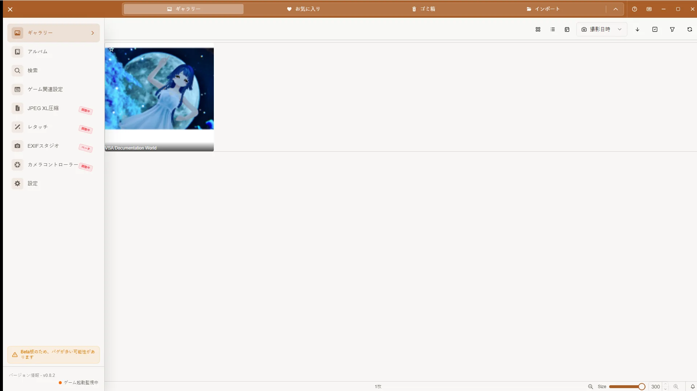

# X投稿機能ガイド

> 準備中・一般向け未公開です。開発中のVSA v0.9.0向けページで、通常設定には表示されません。直接URLから閲覧できます。画面と仕様は変更される可能性があります。

## 開き方

クラウド連携UIが利用できる環境では、ギャラリーから投稿画面を開けます。

画像は配布済みv0.8.2の参考です。現行の開発版v0.9.0とは表示が異なる場合があります。

[🏠 ドキュメントトップ](../index.md) | [⚖️ 利用規約](./terms.md) | [🔒 プライバシーポリシー](./privacy.md)

---

X投稿は一般提供の準備中です。検証対象の環境では、VSAアカウントへのログイン、Xアカウントの連携、利用プランの投稿枠が必要です。通常設定では、X投稿ボタンやクラウドUIは表示されません。

## 投稿手順

1. サイドバーの**ギャラリー**を開きます。
2. 写真の詳細サイドバーからX投稿を開くか、ツールバーのX投稿用選択モードで1～4枚を選びます。
3. 投稿文を入力します。投稿文は280文字以内です。
4. 必要に応じてテンプレートとカメラ情報フレームを設定します。
5. プレビューと利用状況を確認し、投稿ボタンを押して確認ダイアログで実行します。

お気に入りはギャラリー内の**お気に入り**タブから開けます。

### 投稿前の準備

- 未ログインの場合は、モーダルの案内からVSAアカウントにログインします。
- ログイン後にXアカウントが未連携の場合は、**Xアカウントを連携**を選び、ブラウザで認可します。
- モーダルには月間利用数、上限、連携状態が表示されます。上限に達した場合は投稿できません。

### 投稿文とテンプレート

投稿文はモーダルの入力欄で直接編集できます。保存済みプリセットがある場合は**テンプレートを使用する**から選択し、適用後も投稿前に編集できます。テンプレートは保存した文章をそのまま挿入し、`{world}` などの変数を自動展開する機能はありません。

モーダル下部の**プリセットとして保存**から、現在の投稿文を新しいプリセットとして保存できます。

### カメラ情報フレーム

**カメラ情報フレームを追加**をオンにすると、選択した写真すべてにカメラ情報フレームを生成して投稿します。詳細なレイアウト設定は、レタッチ内の**EXIFスタジオ**で行います。フレーム生成中は投稿ボタンが待機状態になります。

投稿用画像はモーダルを開いたときに最適化されます。5MBを超える画像を圧縮して投稿する場合は、その旨が表示されます。

## プリセット管理

設定の**X投稿**パネルでは、投稿プリセットを管理できます。

- **作成**: 名前とテンプレート文章を入力し、必要なら既定値に設定
- **編集**: 名前、テンプレート文章、既定値を変更
- **削除**: 確認ダイアログで削除

現行パネルで管理できるのは名前・テンプレート文章・既定値です。ハッシュタグ、比率、フレームのレイアウトはこのパネルでは設定しません。

## トラブルシューティング

### 投稿ボタンが使えない

VSAアカウントにログインしているか、Xアカウントを連携しているか、月間投稿枠を使い切っていないか確認します。クラウドUIの公開状況やプランによって利用できない場合もあります。

### 投稿に失敗する

ネットワーク接続と利用状況を確認して再試行します。投稿文が280文字以内であること、写真が読み込めることも確認してください。

### カメラ情報フレームを追加できない

EXIFスタジオで利用できる写真情報を確認し、まずフレームなしで投稿できるか試します。生成中は処理が完了するまで待ってください。

## 関連ドキュメント

- [ギャラリー操作ガイド](gallery-guide.md) - 写真選択とお気に入りタブ
- [設定ガイド](settings-guide.md) - X投稿プリセット設定
- [レタッチガイド](retouch-guide.md) - EXIFスタジオとカメラ情報フレーム
